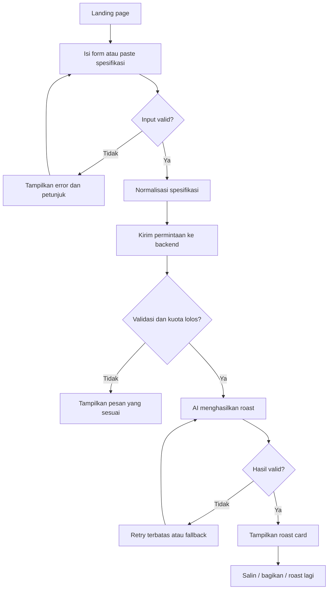
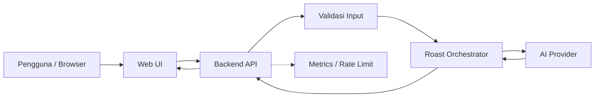

# 01. Project Blueprint — AI Laptop Roaster

> **Ringkasan:** AI Laptop Roaster adalah web app hiburan yang mengubah spesifikasi laptop menjadi roasting brutal berbahasa Indonesia yang lucu, relevan, dan mudah dibagikan ke media sosial.

## Daftar Isi

1. [Ringkasan Eksekutif](#1-ringkasan-eksekutif)
2. [Masalah dan Peluang](#2-masalah-dan-peluang)
3. [Visi, Tujuan, dan Non-goals](#3-visi-tujuan-dan-non-goals)
4. [Pengguna dan Kebutuhan](#4-pengguna-dan-kebutuhan)
5. [Scope MVP](#5-scope-mvp)
6. [Peta Fitur dan Perjalanan Pengguna](#6-peta-fitur-dan-perjalanan-pengguna)
7. [Inventaris Halaman Awal](#7-inventaris-halaman-awal)
8. [Model Data Konseptual](#8-model-data-konseptual)
9. [Integrasi dan Pendekatan AI](#9-integrasi-dan-pendekatan-ai)
10. [Non-functional Requirements](#10-non-functional-requirements)
11. [Keamanan, Privasi, dan Risiko](#11-keamanan-privasi-dan-risiko)
12. [Asumsi, Keputusan, dan Pertanyaan Terbuka](#12-asumsi-keputusan-dan-pertanyaan-terbuka)
13. [Kriteria Keberhasilan dan Validasi](#13-kriteria-keberhasilan-dan-validasi)
14. [Rekomendasi MVP](#14-rekomendasi-mvp)
15. [Project Status dan Approval](#15-project-status-dan-approval)

## 1. Ringkasan Eksekutif

### 1.1 Product vision

Menjadi tempat pengguna menguji nasib laptop mereka melalui roasting AI yang pedas, menghibur, dan cukup relatable untuk dibagikan.

### 1.2 Arah produk yang dikonfirmasi

| Dimensi | Keputusan |
|---|---|
| Platform | Web app responsif untuk desktop dan mobile |
| Input | Form spesifikasi manual dan paste teks |
| Gaya | Brutal, sarkastik, dan berbasis spesifikasi |
| Target utama | Hiburan dan viralitas organik |
| Model bisnis awal | Gratis |
| Bahasa utama | Bahasa Indonesia |

### 1.3 Target pengguna awal

Pelajar, mahasiswa, gamer, pekerja digital, penggemar teknologi, dan pembuat konten yang menikmati humor seputar laptop.

### 1.4 Nilai pembeda

- Roasting merujuk pada spesifikasi yang benar-benar diberikan.
- Bahasa Indonesia sehari-hari, humor pedas, dan meme yang relatable.
- Hasil visual yang mudah disalin atau dibagikan.
- Ringkasan kekuatan, keterbatasan, dan kecocokan penggunaan yang dipisahkan dari humor.

### 1.5 Strategi peluncuran

Gratis, tanpa kewajiban membuat akun pada versi pertama, dan fokus pada distribusi organik melalui hasil roast yang bisa dibagikan.

**Rekomendasi utama:** bangun MVP dengan alur `masukkan spesifikasi → analisis → roasting → bagikan hasil`. Hindari login, leaderboard, marketplace, dan fitur komunitas sampai kebutuhan tersebut tervalidasi.

## 2. Masalah dan Peluang

### 2.1 Masalah yang ingin diselesaikan

- Analisis spesifikasi laptop sering terasa teknis dan membosankan bagi pengguna awam.
- Konten meme laptop menarik, tetapi umumnya tidak personal terhadap perangkat pengguna.
- Pengguna membutuhkan format konten yang singkat, lucu, dan mudah dibagikan.
- AI generatif bisa membuat pengalaman yang lebih personal daripada template meme statis, tetapi perlu dibatasi agar tidak mengarang fakta teknis.

### 2.2 Peluang produk

Menggabungkan dua nilai:
- **Entertainment:** roast yang brutal, sarkastik, dan menghibur.
- **Utility:** penjelasan singkat mengenai kekuatan, kelemahan, dan kecocokan laptop untuk penggunaan tertentu.

Humor menjadi pintu masuk, sedangkan analisis yang masuk akal membantu membangun kepercayaan.

### 2.3 Hipotesis produk

Jika pengguna mendapatkan roasting yang personal dan kartu hasil yang menarik, sebagian dari mereka akan membagikan hasilnya dan membawa pengguna baru tanpa promosi berbayar.

Hipotesis ini perlu diuji melalui data penggunaan, bukan dianggap sudah terbukti.

## 3. Visi, Tujuan, dan Non-goals

### 3.1 Tujuan produk

| ID | Tujuan | Indikator awal |
|---|---|---|
| GOAL-01 | Membuat pengalaman roasting yang menghibur | Pengguna berhasil menghasilkan roast |
| GOAL-02 | Mendorong penyebaran organik | Pengguna membagikan atau menyalin hasil |
| GOAL-03 | Menjaga relevansi teknis | Roast merujuk pada spesifikasi yang diberikan |
| GOAL-04 | Menekan biaya operasional | Biaya AI dan infrastruktur dapat dipantau |
| GOAL-05 | Mengoptimalkan pengalaman mobile | Form dan hasil nyaman digunakan di layar kecil |

Target numerik belum ditetapkan. Angka akan ditentukan setelah baseline awal diketahui.

### 3.2 Non-goals MVP

- Aplikasi native Android/iOS.
- Benchmark perangkat keras secara langsung.
- Deteksi otomatis kondisi fisik atau temperatur laptop.
- Marketplace laptop dan transaksi jual-beli.
- Akun pengguna, profil publik, dan leaderboard.
- Sistem langganan dan monetisasi berbayar.
- Scraping bebas dari seluruh toko online.
- Klaim performa gaming yang presisi tanpa data benchmark pendukung.

## 4. Pengguna dan Kebutuhan

| ID | Segmen | Kebutuhan utama | Prioritas |
|---|---|---|---|
| US-01 | Pelajar/mahasiswa | Menertawakan laptop lama yang digunakan sehari-hari | Utama |
| US-02 | Gamer | Menguji apakah spesifikasi laptop layak untuk game tertentu | Utama |
| US-03 | Tech enthusiast | Mendapatkan roast yang mengacu pada komponen nyata | Utama |
| US-04 | Content creator | Menghasilkan konten lucu yang mudah dibagikan | Utama |
| US-05 | Calon pembeli laptop | Memperoleh gambaran awal tentang kelebihan dan kekurangan perangkat | Sekunder |

Prioritas MVP adalah US-01 sampai US-04. Use case calon pembeli tetap didukung secara terbatas, tetapi aplikasi tidak diposisikan sebagai alat pembelian atau benchmark profesional.

## 5. Scope MVP

### 5.1 MVP — wajib dibangun (P0)

- Form spesifikasi manual: CPU, GPU, RAM, storage, dan penggunaan.
- Input teks: paste spesifikasi atau deskripsi laptop.
- Validasi dan normalisasi input sebelum memanggil AI.
- Roast brutal dalam Bahasa Indonesia.
- Ringkasan kekuatan, kelemahan, dan kecocokan penggunaan.
- Gaya humor brutal dengan batas keamanan dan kontrol konten.
- Hasil berbentuk kartu yang responsif, salin teks, dan bagikan melalui fitur perangkat.
- Loading, error, retry, dan batas penggunaan untuk mengendalikan biaya.

### 5.2 Post-MVP

**P1**
- Upload screenshot spesifikasi dengan OCR atau vision model.
- Battle mode dua laptop.
- Template kartu dan tema visual tambahan.
- Katalog model laptop dengan sumber data yang terverifikasi.

**P2**
- Roast of the day dan leaderboard komunitas.
- Affiliate link atau iklan setelah pola penggunaan dan kelayakan bisnis diuji.

### 5.3 Trade-off

Fitur upload gambar berpotensi membuat produk terasa lebih canggih, tetapi menambah biaya pemrosesan, kompleksitas ekstraksi data, dan kemungkinan salah membaca spesifikasi. Karena itu, input manual dan paste teks lebih realistis untuk MVP pertama.

## 6. Peta Fitur dan Perjalanan Pengguna

### 6.1 Feature map

1. **Input**
   - Form spesifikasi
   - Paste teks
2. **Validasi**
   - Validasi field dan ukuran input
   - Parsing dan normalisasi
3. **AI engine**
   - Analisis spesifikasi yang tersedia
   - Generasi roast
   - Validasi struktur output
4. **Hasil**
   - Julukan laptop
   - Roast
   - Analisis singkat
   - Salin dan bagikan
5. **Operasional**
   - Rate limiting
   - Batas penggunaan
   - Monitoring error dan biaya

### 6.2 Core user journey



### 6.3 Spesifikasi interaksi

- Pengguna tidak perlu membuat akun untuk mencoba roast.
- Input yang tidak diketahui boleh dikosongkan; AI tidak boleh mengisi spesifikasi yang tidak diberikan seolah-olah fakta.
- Pengguna melihat indikator proses ketika AI bekerja.
- Jika AI gagal, input tetap tersedia agar pengguna tidak perlu mengulang dari awal.
- Setelah berhasil, tombol bagikan dan salin harus mudah ditemukan.
- Fitur “roast lagi” tunduk pada batas penggunaan yang sama dengan permintaan pertama.

## 7. Inventaris Halaman Awal

| Screen ID | Halaman | Tujuan | Requirement terkait |
|---|---|---|---|
| SCR-01 | Landing & Input | Menjelaskan produk dan menerima spesifikasi | FR-01, FR-02 |
| SCR-02 | Processing | Memberi umpan balik saat pemrosesan | FR-04 |
| SCR-03 | Roast Result | Menampilkan roast, analisis, dan share card | FR-05, FR-06 |
| SCR-04 | Error / Recovery | Membantu pengguna memperbaiki atau mengulang permintaan | FR-03, FR-07 |
| SCR-05 | Privacy & About | Menjelaskan pengelolaan data dan batasan hasil | NFR-05, SEC-01 |

SCR-02 dan SCR-04 dapat menjadi state pada halaman yang sama, bukan harus halaman terpisah. Ini mengurangi kompleksitas routing dan mempercepat MVP.

## 8. Model Data Konseptual

Rekomendasi awal adalah **stateless processing sebisa mungkin**, dengan penyimpanan minimum untuk pengendalian abuse dan metrik agregat.

| DATA ID | Entitas | Atribut inti | Kebijakan awal |
|---|---|---|---|
| DATA-01 | LaptopInput | CPU, GPU, RAM, storage, model, use case | Diproses sementara |
| DATA-02 | RoastRequest | Request ID, waktu, status, batas penggunaan | Retensi minimum |
| DATA-03 | RoastResult | Roast text, analisis, kategori, skor opsional | Tidak disimpan permanen secara default |
| DATA-04 | UsageCounter | Kuota atau hitungan permintaan | TTL atau agregasi |
| DATA-05 | AggregateAnalytics | Jumlah permintaan, error, share action | Hindari data pribadi |

Skor roasting harus dibedakan dari skor performa. “Tingkat penderitaan laptop” adalah skor humor, bukan ukuran teknis. Bila nanti ada skor performa, definisi dan dasar penilaiannya harus dijelaskan.

## 9. Integrasi dan Pendekatan AI

### 9.1 Arsitektur logis awal



Browser tidak boleh memanggil AI provider dengan API key rahasia secara langsung. Request harus melewati backend untuk validasi, rate limiting, pengendalian biaya, dan pemformatan hasil.

### 9.2 Pembagian tugas AI dan backend

| Proses | Penanggung jawab |
|---|---|
| Memvalidasi field dan batas panjang input | Backend |
| Mengubah input menjadi format terstruktur | Backend, dibantu parser jika perlu |
| Membuat humor yang relevan | AI model |
| Memastikan hasil sesuai format dan batas panjang | Backend + validasi output |
| Menghitung kuota dan mengendalikan request | Backend |
| Menampilkan kartu dan menjalankan fitur share | Frontend |

### 9.3 Prinsip prompt roasting

AI perlu menerima instruksi yang konsisten untuk:
- Menggunakan Bahasa Indonesia sehari-hari dan humor brutal.
- Menyindir spesifikasi atau keterbatasan perangkat, bukan menyerang identitas pemiliknya.
- Menggunakan fakta input sebagai dasar roasting.
- Mengakui informasi yang tidak tersedia.
- Memisahkan candaan dari analisis performa.
- Tidak mengarang benchmark, temperatur, harga, atau kemampuan komponen.
- Menghasilkan struktur yang dapat divalidasi backend.

Contoh output konseptual:

> **Julukan:** Sang Raja Loading  
>
> **Roast:** “RAM 4 GB dan masih berharap multitasking lancar? Laptop ini bukan membuka banyak aplikasi, dia sedang memilih korban.”
>
> **Kelebihan:** Cukup untuk pekerjaan ringan jika aplikasi dan sistemnya sesuai.
>
> **Kekurangan:** Kapasitas RAM terbatas dapat menghambat multitasking modern.
>
> **Kecocokan:** Penggunaan ringan, dengan batasan yang jelas.

Contoh tersebut hanya ilustrasi. Penilaian aktual bergantung pada konfigurasi lengkap, sistem operasi, dan beban kerja.

### 9.4 Batas MVP AI

Jangan langsung membangun database benchmark besar. Mulai dengan pengetahuan umum tentang komponen, aturan heuristik yang transparan, dan AI untuk penyampaian humor.

Jika nanti produk membutuhkan penilaian gaming yang lebih akurat, tambahkan sumber benchmark yang bisa dilacak dan aturan evaluasi per game.

## 10. Non-functional Requirements

Target berikut adalah **usulan awal**, bukan hasil pengukuran aktual.

| ID | Kebutuhan | Target awal |
|---|---|---|
| NFR-01 | Responsivitas | Nyaman digunakan pada ponsel dan desktop |
| NFR-02 | Kinerja UI | Render awal cepat; target LCP p75 ≤ 2,5 detik pada halaman utama |
| NFR-03 | Waktu respons AI | Target p95 ≤ 12 detik, diverifikasi melalui pengujian |
| NFR-04 | Reliabilitas | Error terpantau, retry terbatas, dan fallback yang jelas |
| NFR-05 | Privasi | Tidak memerlukan akun; minimisasi dan retensi data yang jelas |
| NFR-06 | Keamanan | Secret hanya di server, validasi input, rate limit, dan proteksi abuse |
| NFR-07 | Aksesibilitas | Navigasi keyboard, label form, kontras, dan feedback yang jelas |
| NFR-08 | Observability | Metrik latency, error, volume request, dan estimasi biaya AI |
| NFR-09 | Skalabilitas | Dapat meningkatkan kapasitas tanpa harus mengubah seluruh arsitektur |
| NFR-10 | Maintainability | Pemisahan UI, business logic, AI adapter, dan konfigurasi |

Target latency AI tidak sepenuhnya berada dalam kendali aplikasi. Model, panjang prompt, jaringan, dan batas provider bisa memengaruhinya.

## 11. Keamanan, Privasi, dan Risiko

| ID | Risiko | Mitigasi awal |
|---|---|---|
| SEC-01 | API key bocor | Simpan secret pada environment server dan secret manager yang sesuai |
| SEC-02 | Penyalahgunaan endpoint AI | Rate limit, batas ukuran input, dan pembatasan konkurensi |
| SEC-03 | Prompt injection lewat teks paste | Perlakukan teks pengguna sebagai data, bukan instruksi sistem |
| SEC-04 | Biaya melonjak karena bot | Kuota anonim, pemantauan penggunaan, dan circuit breaker |
| SEC-05 | Klaim teknis palsu | Validasi output dan pemisahan humor dari fakta |
| SEC-06 | Data sensitif ikut ditempel | Peringatan agar tidak menyertakan informasi pribadi; minimisasi log |
| RISK-01 | Roast terasa generik | Uji variasi prompt dan relevansi terhadap spesifikasi |
| RISK-02 | Hasil tidak dibagikan | Uji format kartu, copy action, dan share flow |
| RISK-03 | Provider AI tidak tersedia | Adapter provider dan pesan kegagalan yang terkontrol |
| RISK-04 | Biaya gratis tidak berkelanjutan | Batas penggunaan dan evaluasi biaya per roast |

Layanan gratis bukan berarti biaya operasional nol. Karena itu, kuota penggunaan perlu ada sejak awal meskipun tidak ditampilkan sebagai paket premium.

## 12. Asumsi, Keputusan, dan Pertanyaan Terbuka

### 12.1 Known — sudah dikonfirmasi

- Platform: web app.
- Input: form manual dan paste teks.
- Gaya: brutal.
- Tujuan utama: viralitas.
- Model bisnis: gratis.
- Bahasa utama: Indonesia.

### 12.2 Assumed — asumsi untuk rancangan awal

- Pengguna dapat mencoba tanpa akun.
- MVP menggunakan satu AI provider terlebih dahulu.
- Tidak ada penyimpanan permanen untuk hasil roast secara default.
- Kartu hasil dibuat di sisi web app.
- Peluncuran awal ditujukan untuk pengguna berbahasa Indonesia.
- Tidak ada integrasi katalog laptop eksternal pada rilis pertama.
- Penggunaan AI memiliki kuota untuk melindungi anggaran.

### 12.3 Unknown — belum diputuskan

- Domain, identitas merek, dan arah visual.
- Batas biaya AI bulanan.
- Pilihan AI provider dan model.
- Target hosting serta kebutuhan database.
- Apakah share card berupa gambar hasil render atau cukup teks dan Web Share API.
- Apakah akan ada analitik pihak ketiga atau hanya metrik server minimum.

### 12.4 Decision log

| ID | Keputusan | Status |
|---|---|---|
| ADR-001 | Web app sebagai platform awal | Confirmed |
| ADR-002 | Input manual + paste teks | Confirmed |
| ADR-003 | Brutal humor, tetap relevan dan aman | Confirmed |
| ADR-004 | Viral-first, gratis | Confirmed |
| ADR-005 | Tanpa login untuk MVP | Proposed |
| ADR-006 | Tanpa penyimpanan permanen secara default | Proposed |
| ADR-007 | AI provider dan tech stack | Open |

## 13. Kriteria Keberhasilan dan Validasi

MVP harus membuktikan tiga hal: pengguna mau mencoba, hasilnya cukup lucu untuk dibagikan, dan biaya per penggunaan masih terkendali.

### 13.1 Metrik validasi awal

| Metrik | Definisi |
|---|---|
| Activation rate | Persentase pengunjung yang berhasil menghasilkan roast pertama |
| Completion rate | Persentase permintaan valid yang menghasilkan output |
| Share intent | Jumlah aksi salin/bagikan dibanding roast berhasil |
| Repeat usage | Pengguna yang mencoba roast lagi dalam sesi atau periode pengukuran |
| AI cost per roast | Total biaya AI dibagi jumlah roast berhasil |
| Technical error rate | Persentase request yang berakhir gagal |

### 13.2 Rencana pengujian awal

Mulai dengan 20–50 pengguna awal sebagai sampel eksploratif. Evaluasi apakah roast dianggap relevan dan lucu, lalu revisi prompt dan UX sebelum memperluas distribusi. Jumlah tersebut adalah usulan pengujian, bukan ukuran sampel statistik yang menjamin kesimpulan.

## 14. Rekomendasi MVP

### 14.1 Paket MVP

1. Satu halaman utama dengan input spesifikasi, contoh input, dan CTA untuk memulai roast.
2. Satu AI orchestration flow untuk validasi, pengendalian biaya, generasi output, dan pemeriksaan hasil.
3. Satu hasil yang shareable: julukan, roast brutal, analisis singkat, dan tombol bagikan.
4. Operasional minimum yang aman: rate limiting, batas penggunaan, logging minimum, monitoring, dan pengendalian biaya.

### 14.2 Yang sengaja ditunda

- Login dan profil.
- Leaderboard.
- Upload gambar.
- Katalog perangkat.
- Monetisasi.

Alasan utama: produk mendapatkan kesempatan untuk menguji daya tarik humornya lebih dahulu tanpa menghabiskan waktu membangun sistem komunitas atau database spesifikasi yang kompleks.

## 15. Project Status dan Approval

### 15.1 Status artefak

| Artefak | Status |
|---|---|
| Project Blueprint | Disusun; menunggu persetujuan formal |
| PRD | Belum dimulai |
| SDLC | Belum dimulai |
| Architecture & Tech Stack | Belum dimulai |
| UX Architecture | Belum dimulai |
| DESIGN.md | Belum dimulai |
| Google Stitch Prompts | Belum dimulai |
| Master Handoff | Belum dimulai |

### 15.2 Keputusan yang dibawa ke tahap berikutnya

- MVP berfokus pada form/paste, roast, analisis singkat, dan share.
- Tanpa login sebagai asumsi awal.
- Minimalkan penyimpanan data.
- Backend menjadi pengaman untuk AI provider dan biaya.
- Tech stack belum dikunci; pilih setelah kebutuhan dan anggaran operasional dievaluasi.

### 15.3 Open decisions

- Anggaran operasional bulanan AI dan hosting belum diketahui.
- Provider AI, model, dan target deployment belum dipilih.
- Format final share card belum diputuskan.

**Status approval:** pengguna menyatakan `ACC` pada 25 Oktober 2026. Blueprint disetujui untuk dilanjutkan ke tahap PRD, dengan asumsi dan open decisions di atas tetap ditandai dan tidak dianggap sebagai keputusan final.

---

## Context Block untuk sesi berikutnya

```yaml
project_name: "AI Laptop Roaster"
mode: "Guided"
current_stage: "PRD"
approved_artifacts:
  - "01_PROJECT_BLUEPRINT_AI_LAPTOP_ROASTER_v1.0.md"
confirmed_decisions:
  platform: "web"
  input_modes:
    - "manual form"
    - "paste text"
  roast_style: "brutal"
  primary_goal: "viral"
  business_model: "free"
assumptions:
  no_login_mvp: true
  default_persistent_storage: false
  single_ai_provider_initially: true
open_decisions:
  - "monthly AI and hosting budget"
  - "AI provider and model"
  - "deployment target"
  - "share-card format"
next_artifact: "02_PRD_AI_LAPTOP_ROASTER_v1.0.md"
```
