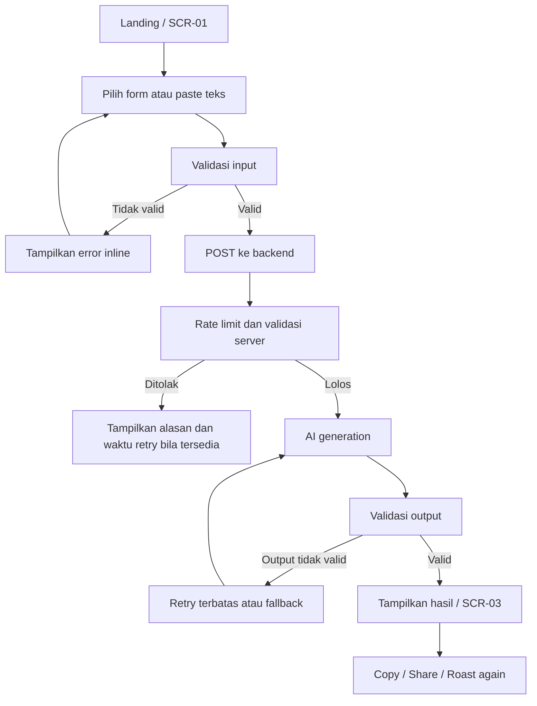
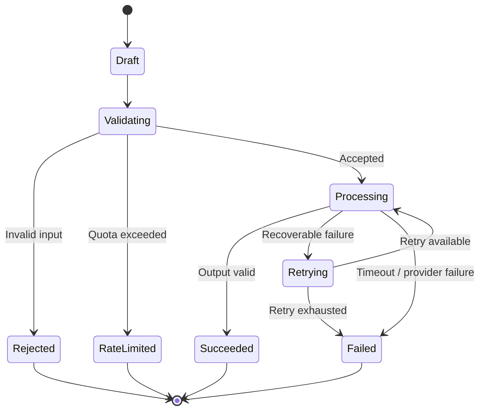

# 02. Product Requirements Document (PRD) — AI Laptop Roaster

> **Tujuan dokumen:** Mendefinisikan kebutuhan produk yang dapat diuji untuk MVP AI Laptop Roaster. Dokumen ini menjabarkan apa yang harus dilakukan produk dan mengapa, tanpa mengunci framework, AI provider, atau hosting sebelum ada alasan yang cukup.

## Daftar Isi

1. [Ringkasan Produk](#1-ringkasan-produk)
2. [Tujuan dan Prinsip Produk](#2-tujuan-dan-prinsip-produk)
3. [Pengguna, Role, dan Akses](#3-pengguna-role-dan-akses)
4. [Scope dan Prioritas](#4-scope-dan-prioritas)
5. [Information Architecture dan User Journey](#5-information-architecture-dan-user-journey)
6. [Functional Requirements](#6-functional-requirements)
7. [Business Rules dan State](#7-business-rules-dan-state)
8. [Data Requirements](#8-data-requirements)
9. [AI Roast Engine Requirements](#9-ai-roast-engine-requirements)
10. [Non-functional Requirements](#10-non-functional-requirements)
11. [Security, Privacy, dan Abuse Prevention](#11-security-privacy-dan-abuse-prevention)
12. [UX, Accessibility, dan Analytics](#12-ux-accessibility-dan-analytics)
13. [Operasional dan Kegagalan](#13-operasional-dan-kegagalan)
14. [Acceptance Criteria dan Test Matrix](#14-acceptance-criteria-dan-test-matrix)
15. [Release Plan](#15-release-plan)
16. [Risiko dan Open Decisions](#16-risiko-dan-open-decisions)
17. [Traceability](#17-traceability)
18. [Approval dan Context Block](#18-approval-dan-context-block)

## 1. Ringkasan Produk

AI Laptop Roaster adalah web app hiburan berbahasa Indonesia yang menerima spesifikasi laptop melalui form atau teks yang ditempel pengguna, lalu menghasilkan roasting brutal yang lucu dan relevan. Hasil juga menyediakan analisis singkat mengenai kekuatan, keterbatasan, dan kecocokan penggunaan laptop, dengan jelas membedakan humor dari penilaian teknis.

### 1.1 Keputusan produk yang telah dikonfirmasi

| Area | Keputusan |
|---|---|
| Platform | Web app responsif |
| Metode input MVP | Form manual dan paste teks |
| Gaya utama | Brutal, sarkastik, meme-friendly |
| Tujuan utama | Hiburan dan viralitas organik |
| Model bisnis awal | Gratis |
| Bahasa utama | Bahasa Indonesia |

### 1.2 Asumsi kerja

- Pengguna dapat mencoba tanpa membuat akun.
- MVP menggunakan satu AI provider pada awalnya.
- Hasil roast tidak disimpan permanen secara default.
- Request AI selalu melewati backend.
- Kuota anonim dan rate limit digunakan untuk mengendalikan biaya.
- Upload gambar, katalog perangkat, battle mode, dan leaderboard bukan bagian dari MVP.

Asumsi tersebut bukan keputusan final apabila ada constraint bisnis atau operasional yang berbeda.

## 2. Tujuan dan Prinsip Produk

### 2.1 Product goals

| ID | Tujuan | Ukuran keberhasilan |
|---|---|---|
| GOAL-01 | Pengguna bisa menghasilkan roast dengan mudah | Activation dan completion rate |
| GOAL-02 | Output cukup menarik untuk dibagikan | Aksi copy/share per roast berhasil |
| GOAL-03 | Roast terasa spesifik terhadap input | Penilaian relevansi dalam usability test |
| GOAL-04 | Informasi teknis tidak menyesatkan | Tidak ada klaim spesifikasi yang tidak didukung input |
| GOAL-05 | Penggunaan gratis dapat dikendalikan | Biaya AI per roast terukur dan di bawah budget yang ditetapkan |
| GOAL-06 | Pengalaman mobile layak | Alur utama berhasil pada viewport mobile |

### 2.2 Prinsip produk

1. **Humor berbasis fakta:** candaan sebaiknya merujuk pada spesifikasi yang tersedia.
2. **Brutal, bukan menyerang pribadi:** roast perangkat, bukan identitas atau karakter pemiliknya.
3. **Jujur terhadap ketidakpastian:** data yang tidak diketahui tidak boleh direka sebagai fakta.
4. **Share-first:** hasil harus ringkas, mudah dibaca, dan mudah disalin/dibagikan.
5. **Minim data:** jangan meminta informasi pribadi yang tidak dibutuhkan.
6. **Cost-aware:** endpoint generasi AI harus memiliki kontrol penggunaan.
7. **Progressive scope:** fitur tambahan masuk setelah MVP divalidasi.

### 2.3 Non-goals MVP

- Benchmark perangkat keras langsung atau pengukuran suhu.
- Jaminan FPS game atau performa aplikasi yang presisi tanpa data benchmark terverifikasi.
- Akun, profil, leaderboard, dan komunitas.
- Upload gambar/screenshot spesifikasi.
- Marketplace, transaksi, atau affiliate.
- Pembayaran, subscription, dan monetisasi berbayar.
- Scraping massal dari toko online.

## 3. Pengguna, Role, dan Akses

### 3.1 Role MVP

| Role ID | Role | Kemampuan |
|---|---|---|
| ROLE-01 | Pengunjung anonim | Mengisi input, meminta roast dalam kuota, melihat hasil, menyalin dan membagikan |
| ROLE-02 | Operator/admin teknis | Mengelola konfigurasi melalui lingkungan server yang aman, memantau metrik dan error; tidak memerlukan dashboard admin khusus pada MVP |

Tidak ada role akun terdaftar pada MVP.

### 3.2 Access matrix

| Aksi | Pengunjung anonim | Operator teknis |
|---|---:|---:|
| Mengirim spesifikasi | Ya | Untuk pengujian |
| Melihat hasil request sendiri di sesi aktif | Ya | Sesuai kebutuhan debugging yang dibatasi |
| Menyalin/membagikan hasil | Ya | Ya |
| Mengubah konfigurasi provider | Tidak | Ya, melalui konfigurasi aman |
| Melihat agregat metrik | Tidak | Ya |
| Melihat input mentah pengguna dari log | Tidak | Dihindari; akses khusus hanya jika benar-benar diperlukan |

## 4. Scope dan Prioritas

### 4.1 P0 — MVP wajib

- SCR-01 landing dan input form.
- Mode input form manual dan paste teks.
- Validasi input dan normalisasi spesifikasi.
- Endpoint backend untuk request roast.
- Rate limit dan kuota anonim.
- AI generation dengan output terstruktur.
- Validasi output AI.
- Tampilan hasil roast dan analisis singkat.
- Copy dan native share/fallback share.
- Loading, empty, error, timeout, retry terbatas, dan rate-limit states.
- Privacy/About page atau section.
- Monitoring minimal untuk latency, error, volume request, dan estimasi biaya.

### 4.2 P1 — sesudah validasi awal

- Upload screenshot dan OCR/vision extraction.
- Battle mode dua laptop.
- Variasi tema share card.
- Katalog model laptop dengan sumber terverifikasi.
- Riwayat lokal opsional di browser, bila dibutuhkan pengguna.

### 4.3 P2 — eksplorasi lanjutan

- Leaderboard komunitas.
- Roast of the day.
- Akun dan profil.
- Iklan atau affiliate setelah evaluasi pengalaman pengguna dan kelayakan bisnis.

## 5. Information Architecture dan User Journey

### 5.1 Screen inventory

| Screen ID | Nama | Elemen utama | State terkait |
|---|---|---|---|
| SCR-01 | Landing & Input | Value proposition, mode input, form, CTA, contoh | Default, validation error |
| SCR-02 | Processing | Status proses, indikator loading, pesan menunggu | Loading, timeout |
| SCR-03 | Roast Result | Julukan, roast, analisis, copy/share, roast again | Success |
| SCR-04 | Error / Recovery | Pesan error, solusi, retry | Network/provider error, quota |
| SCR-05 | Privacy & About | Penjelasan data, keterbatasan AI, kontak/feedback bila tersedia | Static content |

SCR-02 dan SCR-04 dapat diimplementasikan sebagai state pada halaman yang sama; pemisahan screen ID tidak mewajibkan route tersendiri.

### 5.2 User flow utama



### 5.3 Input mode behavior

- Pengguna dapat memilih form atau paste teks.
- Mode input harus jelas dan tidak menghapus data tanpa konfirmasi.
- Pengguna dapat mengisi sebagian spesifikasi; field yang tidak diketahui boleh kosong.
- Untuk paste teks, backend/parser hanya mengekstrak fakta yang teridentifikasi dengan keyakinan memadai.
- Jika parsing tidak yakin, sistem meminta pengguna mengoreksi atau melengkapi field, bukan menebak diam-diam.

## 6. Functional Requirements

### 6.1 Input dan validasi

| ID | Requirement | Prioritas |
|---|---|---|
| FR-01 | Sistem harus menyediakan form untuk model laptop (opsional), CPU, GPU (opsional), RAM, storage, dan tujuan penggunaan. | P0 |
| FR-02 | Sistem harus menyediakan input teks untuk menempelkan deskripsi atau spesifikasi laptop. | P0 |
| FR-03 | Sistem harus memvalidasi batas ukuran, tipe field, dan input yang tidak masuk akal sebelum request diproses. | P0 |
| FR-04 | Sistem harus mengizinkan spesifikasi yang tidak diketahui untuk dikosongkan dan menandainya sebagai unknown. | P0 |
| FR-05 | Sistem harus menampilkan error yang menjelaskan cara memperbaiki input. | P0 |

### 6.2 Generasi roast

| ID | Requirement | Prioritas |
|---|---|---|
| FR-06 | Sistem harus mengirim input valid ke backend untuk diproses melalui AI provider. | P0 |
| FR-07 | Sistem harus menghasilkan julukan laptop dan roast dalam Bahasa Indonesia dengan gaya brutal. | P0 |
| FR-08 | Sistem harus menghasilkan ringkasan kekuatan, keterbatasan, dan kecocokan penggunaan jika data mendukung. | P0 |
| FR-09 | Sistem harus memisahkan konten humor dari penilaian teknis. | P0 |
| FR-10 | Sistem tidak boleh menyajikan spesifikasi, benchmark, suhu, harga, atau hasil FPS yang tidak didukung sumber/input sebagai fakta. | P0 |
| FR-11 | Sistem harus memvalidasi struktur dan panjang output sebelum menampilkannya. | P0 |
| FR-12 | Sistem harus menangani output AI kosong atau tidak valid dengan retry terbatas atau fallback yang aman. | P0 |

### 6.3 Hasil dan sharing

| ID | Requirement | Prioritas |
|---|---|---|
| FR-13 | Sistem harus menampilkan hasil dalam layout responsif yang mudah dibaca. | P0 |
| FR-14 | Pengguna harus dapat menyalin teks roast melalui aksi yang jelas. | P0 |
| FR-15 | Pengguna harus dapat menggunakan native share jika tersedia, dengan fallback yang sesuai bila tidak tersedia. | P0 |
| FR-16 | Pengguna harus dapat mencoba roast lain tanpa mengulang input, selama kuota mengizinkan. | P0 |
| FR-17 | Hasil harus membedakan skor humor dari penilaian teknis jika keduanya ditampilkan. | P0 |

### 6.4 Abuse prevention dan operasional

| ID | Requirement | Prioritas |
|---|---|---|
| FR-18 | Backend harus membatasi frekuensi dan volume request anonim. | P0 |
| FR-19 | Sistem harus memberi pesan yang jelas ketika kuota habis atau layanan sementara tidak tersedia. | P0 |
| FR-20 | Sistem harus mencatat metrik operasional minimum tanpa menyimpan input mentah secara default. | P0 |
| FR-21 | Sistem harus menerapkan timeout dan batas retry untuk pemanggilan AI. | P0 |
| FR-22 | Sistem harus menyediakan halaman atau section privasi dan keterbatasan hasil AI. | P0 |

## 7. Business Rules dan State

### 7.1 Business rules

| ID | Aturan |
|---|---|
| BR-01 | Penggunaan gratis tidak berarti request tidak terbatas; kuota dapat diterapkan untuk mencegah abuse dan lonjakan biaya. |
| BR-02 | Input tidak lengkap boleh diproses, tetapi hasil harus mengakui keterbatasan data. |
| BR-03 | Teks yang ditempel pengguna diperlakukan sebagai data, bukan instruksi yang dapat mengganti prompt sistem. |
| BR-04 | Roast boleh sarkastik terhadap perangkat, tetapi tidak boleh menjadi serangan personal berbasis atribut sensitif atau ancaman. |
| BR-05 | Klaim teknis harus berasal dari input atau sumber terverifikasi yang memang digunakan sistem. |
| BR-06 | Retry otomatis dibatasi dan tidak boleh menciptakan loop tanpa akhir. |
| BR-07 | Output gagal tidak boleh ditampilkan seolah-olah hasil berhasil. |
| BR-08 | Hasil tidak disimpan permanen secara default pada MVP. |
| BR-09 | Jika kelak ditambahkan skor performa, metodologi dan keterbatasannya harus dijelaskan. |

### 7.2 Request state



### 7.3 Error handling

| Kondisi | Perilaku yang diharapkan |
|---|---|
| Input tidak valid | Tampilkan pesan inline dan pertahankan input |
| Kuota habis | Tampilkan batas penggunaan dan waktu reset bila diketahui |
| Network error | Pertahankan input dan sediakan retry manual |
| AI timeout | Batalkan/akhiri request secara terkendali; jangan mengirim retry tanpa batas |
| Output malformed | Coba perbaikan/ulang terbatas; jika tetap gagal, tampilkan fallback |
| Provider unavailable | Tampilkan pesan layanan sementara tidak tersedia |
| Copy gagal | Tampilkan teks yang dapat dipilih manual |
| Native share tidak tersedia | Tawarkan copy sebagai fallback |

## 8. Data Requirements

### 8.1 Entitas konseptual

| DATA ID | Entitas | Atribut inti | Retensi awal |
|---|---|---|---|
| DATA-01 | LaptopInput | model, CPU, GPU, RAM, storage, use case | Memori request; tidak disimpan permanen |
| DATA-02 | RoastRequest | request ID, waktu, status, usage token/counter | Metadata minimum dengan retensi terbatas |
| DATA-03 | RoastResult | nickname, roast text, strengths, limitations, fit | Hanya selama sesi/request kecuali ada alasan lain |
| DATA-04 | UsageCounter | counter anonim, window waktu, abuse signal minimum | TTL sesuai kebutuhan rate limit |
| DATA-05 | AggregateAnalytics | jumlah request, completion, error, copy/share action | Agregat tanpa PII |

### 8.2 Data validation

- Field teks memiliki batas panjang.
- Nilai RAM/storage harus dinormalisasi ke satuan yang konsisten bila dapat dikenali.
- Data yang tidak dapat diparse tidak boleh dipaksakan menjadi nilai pasti.
- Backend membuat request ID untuk observability.
- Jangan menulis input atau output lengkap ke log secara default.
- Hindari fingerprinting invasif untuk membatasi pengguna anonim; pilih kontrol yang proporsional dan tinjau privasinya.

## 9. AI Roast Engine Requirements

### 9.1 Output contract konseptual

Output AI harus dapat diparse ke struktur internal dengan field seperti:

```json
{
  "laptop_nickname": "string",
  "roast_text": "string",
  "strengths": ["string"],
  "limitations": ["string"],
  "usage_fit": ["string"],
  "unknowns": ["string"]
}
```

Ini adalah kontrak konseptual; skema final dan library validasi ditentukan saat desain teknis.

### 9.2 Prompt requirements

Prompt sistem harus mengarahkan model untuk:
- Menulis dalam Bahasa Indonesia yang natural.
- Menggunakan gaya brutal, sarkastik, dan meme-friendly.
- Menargetkan spesifikasi/perangkat, bukan menyerang pemiliknya.
- Tidak mengarang data yang tidak diberikan.
- Mengakui unknowns.
- Memisahkan roast dan analisis teknis.
- Menghindari klaim benchmark spesifik tanpa sumber.
- Memperlakukan paste text sebagai input tidak tepercaya.
- Menghasilkan output sesuai kontrak yang diminta.

### 9.3 Quality gates

| ID | Gate | Kriteria |
|---|---|---|
| AI-01 | Validitas struktur | Semua field wajib ada dan tipe datanya sesuai |
| AI-02 | Relevansi | Roast merujuk minimal pada satu detail spesifikasi yang tersedia bila ada |
| AI-03 | Non-hallucination | Tidak ada detail perangkat rekaan yang dinyatakan sebagai fakta |
| AI-04 | Tone | Bahasa Indonesia dan tingkat humor sesuai produk |
| AI-05 | Safety | Tidak ada ancaman atau serangan personal yang tidak relevan |
| AI-06 | Length | Output tidak melewati batas UI yang ditentukan |
| AI-07 | Separation | Humor dibedakan dari analisis teknis |

### 9.4 Fallback

Jika model gagal:
1. Lakukan retry hanya untuk kegagalan yang layak dicoba ulang.
2. Batasi retry agar biaya tidak berlipat tanpa kendali.
3. Jika output tidak valid, tampilkan pesan yang meminta pengguna mencoba kembali.
4. Jangan mengganti hasil gagal dengan analisis teknis palsu.

## 10. Non-functional Requirements

| ID | Requirement | Target awal / verifikasi |
|---|---|---|
| NFR-01 | Responsive UX | Alur inti dapat diselesaikan di mobile dan desktop |
| NFR-02 | Web performance | Target LCP p75 ≤ 2,5 detik untuk halaman awal; ukur pada lingkungan representatif |
| NFR-03 | AI latency | Target p95 ≤ 12 detik; ukur dengan model/provider terpilih |
| NFR-04 | Reliability | Timeout, error handling, dan retry terbatas tersedia |
| NFR-05 | Privacy | Tanpa akun; minimisasi data dan retensi terdokumentasi |
| NFR-06 | Security | Secret hanya di server; input validation dan rate limiting |
| NFR-07 | Accessibility | Keyboard access, label, focus state, contrast, dan feedback |
| NFR-08 | Observability | Metrik request, latency, error, dan estimasi biaya |
| NFR-09 | Scalability | Komponen AI dapat diganti tanpa rewrite seluruh UI |
| NFR-10 | Maintainability | UI, business logic, provider adapter, dan config dipisahkan |
| NFR-11 | Cost control | Kuota, batas konkurensi, timeout, dan budget alert/circuit breaker bila didukung |
| NFR-12 | Compatibility | Mendukung browser modern utama; daftar pasti ditetapkan saat implementasi |

Target di atas merupakan proposal awal, bukan SLA yang telah teruji.

## 11. Security, Privacy, dan Abuse Prevention

### 11.1 Kontrol minimum

- Simpan API key hanya di server-side secret/environment configuration.
- Terapkan batas ukuran body, validasi schema, dan rate limit.
- Gunakan timeout untuk pemanggilan provider.
- Batasi retry dan concurrency.
- Perlakukan semua input pengguna sebagai untrusted.
- Hindari menyimpan input/output mentah dalam log.
- Sediakan privacy notice yang menjelaskan pemrosesan AI dan retensi.
- Tetapkan kebijakan penanganan abuse dan pemantauan biaya.
- Jangan memasukkan credential atau PII nyata dalam contoh maupun test fixture.

### 11.2 Risiko dan mitigasi

| ID | Risiko | Mitigasi | Residual concern |
|---|---|---|---|
| SEC-01 | API key bocor | Server-only secret | Salah konfigurasi deployment |
| SEC-02 | Bot menghabiskan kuota | Rate limit, kuota, concurrency cap | Abuse terdistribusi |
| SEC-03 | Prompt injection dari paste | Isolasi instruksi dan data | Model tetap dapat salah mengikuti konteks |
| SEC-04 | Data pribadi ikut ditempel | Warning, minimisasi log, retensi terbatas | Pengguna dapat mengabaikan warning |
| SEC-05 | Klaim teknis palsu | Output gate dan pemisahan analisis | Pengetahuan umum model dapat tidak akurat |
| SEC-06 | Konten roasting melampaui batas | Guardrails dan evaluasi sampel | Penilaian humor bersifat kontekstual |
| RISK-01 | Biaya AI tidak terkendali | Monitoring biaya dan circuit breaker | Tarif/provider berubah |
| RISK-02 | Provider outage | Timeout, fallback, adapter | Ketersediaan alternatif belum diputuskan |

## 12. UX, Accessibility, dan Analytics

### 12.1 UX requirements

- CTA utama harus jelas, misalnya “Roast Laptop-ku”.
- Field wajib dan opsional harus dibedakan.
- Berikan contoh spesifikasi yang bisa ditempel.
- Tampilkan indikator proses yang tidak menyesatkan tentang estimasi waktu.
- Hasil roast harus menjadi fokus visual utama.
- Analisis teknis harus mudah dibedakan dari bagian humor.
- Tombol copy/share harus memiliki label yang jelas.
- Hasil harus tetap terbaca pada layar kecil.
- Gunakan empty, loading, success, error, timeout, dan quota states yang konsisten.

### 12.2 Accessibility

- Semua kontrol utama dapat digunakan dengan keyboard.
- Input memiliki label programatik.
- Error dikaitkan dengan field yang bermasalah.
- Focus indicator terlihat.
- Jangan menyampaikan status hanya melalui warna.
- Kontras teks dan kontrol harus memadai.
- Hindari animasi yang mengganggu; hormati preferensi reduced motion bila ada animasi.

### 12.3 Analytics events

| Event ID | Event | Properti minimum |
|---|---|---|
| EVT-01 | `landing_view` | timestamp, anonymous session ID jika diperlukan |
| EVT-02 | `input_mode_selected` | mode: form/paste |
| EVT-03 | `roast_submitted` | request ID, input mode |
| EVT-04 | `roast_completed` | request ID, latency bucket/status |
| EVT-05 | `roast_failed` | request ID, error category |
| EVT-06 | `roast_copied` | request ID |
| EVT-07 | `share_initiated` | request ID, share method |
| EVT-08 | `roast_again_clicked` | request ID |

Jangan mengirim spesifikasi lengkap, teks roast, atau data pribadi ke analytics secara default. Pengukuran share dari browser mungkin hanya mencatat inisiasi, bukan memastikan konten benar-benar dipublikasikan.

## 13. Operasional dan Kegagalan

### 13.1 Observability minimum

Pantau:
- Total request dan request sukses.
- Latency backend dan provider.
- Timeout, error, dan output invalid.
- Rate-limit rejection.
- Estimasi biaya provider.
- Aksi copy/share dalam bentuk event agregat.

### 13.2 Operasional

- Konfigurasi provider dan batas penggunaan harus dapat diubah tanpa mengubah UI.
- Hindari retry tanpa batas.
- Sediakan alert atau mekanisme penghentian sementara jika biaya melewati ambang yang ditetapkan.
- Jangan mengklaim backup database jika MVP tidak menyimpan data persisten.
- Jika konfigurasi atau metrik disimpan, dokumentasikan backup dan recovery yang sesuai.
- Uji provider outage, quota exhaustion, dan deployment rollback sebelum rilis publik.

## 14. Acceptance Criteria dan Test Matrix

### 14.1 Acceptance criteria

| Test ID | Requirement terkait | Skenario | Hasil yang diharapkan |
|---|---|---|---|
| TEST-01 | FR-01, FR-03 | Input CPU dan RAM valid | Form diterima dan dapat dikirim |
| TEST-02 | FR-04 | GPU tidak diketahui | Input tetap dapat diproses dan GPU ditandai unknown |
| TEST-03 | FR-02, FR-05 | Paste teks terlalu panjang | Sistem menolak atau meminta pemendekan dengan pesan jelas |
| TEST-04 | FR-06, FR-07 | Request valid dan provider tersedia | Roast Bahasa Indonesia ditampilkan |
| TEST-05 | FR-08, FR-09 | Output berisi roast dan analisis | Kedua bagian terpisah dan mudah dikenali |
| TEST-06 | FR-10, AI-03 | Input tidak menyertakan suhu/FPS | Sistem tidak mengarang suhu/FPS sebagai fakta |
| TEST-07 | FR-11, FR-12 | Model mengembalikan JSON malformed | Validasi gagal, retry terbatas/fallback dijalankan |
| TEST-08 | FR-14 | Klik copy | Teks tersalin atau fallback manual ditampilkan |
| TEST-09 | FR-15 | Native share tidak tersedia | Pengguna mendapat opsi copy |
| TEST-10 | FR-18, FR-19 | Melewati kuota | Request ditolak dan pesan kuota ditampilkan |
| TEST-11 | FR-21 | Provider timeout | Request berakhir terkendali; tidak ada retry tak terbatas |
| TEST-12 | SEC-01 | Inspeksi client bundle | Tidak ada secret provider di browser |
| TEST-13 | SEC-03 | Paste berisi instruksi untuk mengabaikan aturan | Teks diperlakukan sebagai data; system policy tetap berlaku |
| TEST-14 | NFR-01, NFR-07 | Alur inti pada mobile dan keyboard | Form, submit, hasil, copy dapat digunakan |
| TEST-15 | NFR-08, FR-20 | Request berhasil/gagal | Metrik status dan latency tercatat tanpa raw input secara default |
| TEST-16 | FR-16 | Klik roast again saat kuota tersedia | Request baru menggunakan input yang masih ada |

### 14.2 Definition of Ready (DoR)

Sebuah requirement siap dikerjakan bila:
- Tujuan dan perilaku yang diharapkan jelas.
- Acceptance criteria dapat diuji.
- Dependency diketahui.
- State error dan edge case penting tercatat.
- Dampak data, privasi, dan keamanan dipahami.

### 14.3 Definition of Done (DoD)

Fitur dianggap selesai bila:
- Implementasi memenuhi acceptance criteria.
- Unit/integration test yang relevan lulus.
- Error dan loading states tersedia.
- Tidak ada secret di client bundle.
- Accessibility dasar diperiksa.
- Metrik/error handling relevan tersedia.
- Dokumentasi konfigurasi dan perilaku diperbarui.

## 15. Release Plan

### Release 0 — Prototype

- Uji input form/paste dan prompt dengan contoh spesifikasi.
- Evaluasi relevansi, humor, panjang output, dan konsistensi.
- Belum untuk trafik publik tanpa kontrol biaya dan keamanan.

### Release 1 — MVP private beta

- Deploy ke lingkungan terbatas.
- Aktifkan rate limit, timeout, observability, privacy notice, dan share/copy.
- Uji dengan 20–50 pengguna awal sebagai sampel eksploratif.
- Catat feedback tentang kualitas roast dan UX.

### Release 2 — Public MVP

- Perbaiki prompt dan UX berdasarkan beta.
- Tetapkan kuota dan batas biaya operasional.
- Lakukan smoke test dan rollback rehearsal.
- Publikasikan hanya setelah acceptance criteria P0 lulus.

### Release 3 — Evaluasi post-MVP

Pertimbangkan upload gambar, battle mode, atau fitur tambahan berdasarkan bukti penggunaan, biaya, dan feedback.

## 16. Risiko dan Open Decisions

### 16.1 Risiko produk

| ID | Risiko | Dampak | Respons |
|---|---|---|---|
| RISK-01 | Roast generik | Engagement rendah | Prompt iteration dan user testing |
| RISK-02 | Tidak ada sharing | Pertumbuhan organik rendah | Perbaiki result card dan CTA |
| RISK-03 | Klaim teknis salah | Hilangnya kepercayaan | Unknown handling, validation, sumber benchmark bila diperlukan |
| RISK-04 | AI terlalu mahal | Layanan gratis tidak berkelanjutan | Quota, cost monitoring, model/provider evaluation |
| RISK-05 | Abuse anonim | Gangguan layanan dan biaya | Rate limiting dan controls berlapis |
| RISK-06 | Provider tidak tersedia | Request gagal | Error handling dan adapter provider |

### 16.2 Open decisions

| ID | Keputusan | Status | Dampak |
|---|---|---|---|
| OPEN-01 | Anggaran bulanan AI + hosting | Belum ditentukan | Memengaruhi kuota, provider, dan deployment |
| OPEN-02 | AI provider/model | Belum ditentukan | Memengaruhi kualitas, latency, biaya, dan data handling |
| OPEN-03 | Target deployment | Belum ditentukan | Memengaruhi arsitektur runtime dan operasi |
| OPEN-04 | Format share card final | Belum ditentukan | Memengaruhi implementasi rendering dan UX |
| OPEN-05 | Analytics pihak ketiga atau server-side minimum | Belum ditentukan | Memengaruhi privasi dan instrumentasi |

### 16.3 Asumsi dan batas keputusan

Tech stack tidak dikunci pada PRD ini. Pemilihan teknologi harus mengevaluasi kebutuhan produk, kemampuan tim, biaya, deployment, keamanan, observability, dan kompleksitas operasional. Jangan memilih teknologi hanya karena populer.

## 17. Traceability

| Goal | Requirement | Screen | Test |
|---|---|---|---|
| GOAL-01 | FR-01–FR-12 | SCR-01, SCR-02, SCR-03, SCR-04 | TEST-01–TEST-07, TEST-11 |
| GOAL-02 | FR-13–FR-16 | SCR-03 | TEST-08, TEST-09, TEST-16 |
| GOAL-03 | FR-08–FR-12 | SCR-03, SCR-04 | TEST-05–TEST-07, TEST-13 |
| GOAL-04 | FR-18–FR-21 | SCR-02, SCR-04 | TEST-10, TEST-11, TEST-15 |
| GOAL-05 | FR-13–FR-16, NFR-01 | SCR-01, SCR-03 | TEST-08, TEST-09, TEST-14 |
| Privacy/security | FR-20, FR-22, SEC-01–SEC-06 | SCR-05 | TEST-12, TEST-13, TEST-15 |

## 18. Approval dan Context Block

### 18.1 Status dokumen

| Artefak | Status |
|---|---|
| 01 Project Blueprint | ACC diberikan pengguna |
| 02 PRD | Disusun; menunggu ACC formal untuk tahap ini |
| 03 SDLC | Belum dimulai |
| 04 Architecture & Tech Stack | Belum dimulai |
| 05 UX Architecture | Belum dimulai |
| 06 DESIGN.md | Belum dimulai |
| 07 Stitch Prompts | Belum dimulai |
| 08 Master Handoff | Belum dimulai |

### 18.2 Context Block

```yaml
project_name: "AI Laptop Roaster"
mode: "Guided"
current_stage: "PRD"
blueprint_status: "ACC"
prd_status: "Draft — awaiting formal ACC"
confirmed_decisions:
  platform: "web"
  input_modes:
    - "manual form"
    - "paste text"
  roast_style: "brutal"
  primary_goal: "viral"
  business_model: "free"
assumptions:
  no_login_mvp: true
  default_persistent_storage: false
  single_ai_provider_initially: true
  backend_mediates_ai_requests: true
open_decisions:
  - "monthly AI and hosting budget"
  - "AI provider and model"
  - "deployment target"
  - "share-card format"
  - "analytics approach"
next_artifact: "03_SDLC_AI_LAPTOP_ROASTER_v1.0.md"
```

### 18.3 Permintaan persetujuan

PRD ini mendefinisikan kebutuhan MVP dan kriteria pengujiannya. Keputusan provider, hosting, anggaran, dan format share card tetap terbuka sampai tahap arsitektur.

**ACC Tahap PRD dan lanjut ke SDLC?** Jawab `ACC`, atau tulis bagian yang ingin direvisi.
