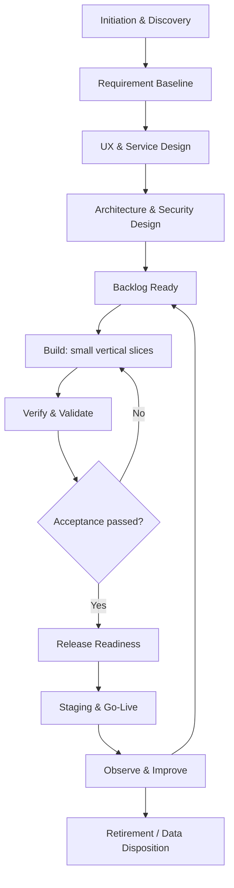

# 03. Software Development Life Cycle (SDLC) — AI Laptop Roaster

> **Tujuan dokumen:** Menetapkan proses kerja yang ringan tetapi disiplin untuk mengubah PRD AI Laptop Roaster menjadi MVP yang dapat diuji, dirilis, dipantau, dan dipelihara. Dokumen ini menggunakan asumsi tim kecil; proses dapat diperketat ketika risiko, traffic, atau ukuran tim meningkat.

## Daftar Isi

1. [Ringkasan Eksekutif](#1-ringkasan-eksekutif)
2. [Tujuan, Scope, dan Prinsip](#2-tujuan-scope-dan-prinsip)
3. [Model Lifecycle](#3-model-lifecycle)
4. [Governance, Role, dan RACI](#4-governance-role-dan-raci)
5. [Stage Gates dan Approval](#5-stage-gates-dan-approval)
6. [Phase 0 — Initiation dan Discovery](#6-phase-0--initiation-dan-discovery)
7. [Phase 1 — Requirement Baseline](#7-phase-1--requirement-baseline)
8. [Phase 2 — UX dan Service Design](#8-phase-2--ux-dan-service-design)
9. [Phase 3 — Architecture, Data, dan Security Design](#9-phase-3--architecture-data-dan-security-design)
10. [Phase 4 — Planning dan Backlog Readiness](#10-phase-4--planning-dan-backlog-readiness)
11. [Phase 5 — Development](#11-phase-5--development)
12. [Phase 6 — Verification dan Validation](#12-phase-6--verification-dan-validation)
13. [Phase 7 — Release Readiness](#13-phase-7--release-readiness)
14. [Phase 8 — Deployment dan Go-Live](#14-phase-8--deployment-dan-go-live)
15. [Phase 9 — Operate, Observe, Improve](#15-phase-9--operate-observe-improve)
16. [Phase 10 — Retirement dan Data Disposition](#16-phase-10--retirement-dan-data-disposition)
17. [Backlog dan Change Control](#17-backlog-dan-change-control)
18. [Repository dan Branching Strategy](#18-repository-dan-branching-strategy)
19. [Environment Strategy](#19-environment-strategy)
20. [Coding dan Review Standards](#20-coding-dan-review-standards)
21. [Test Strategy](#21-test-strategy)
22. [Security dan Privacy SDLC](#22-security-dan-privacy-sdlc)
23. [Data Lifecycle](#23-data-lifecycle)
24. [CI/CD dan Release Management](#24-cicd-dan-release-management)
25. [Incident, Hotfix, dan Rollback](#25-incident-hotfix-dan-rollback)
26. [Dependency dan Upgrade Management](#26-dependency-dan-upgrade-management)
27. [Documentation dan Artifact Management](#27-documentation-dan-artifact-management)
28. [Metrics dan Continuous Improvement](#28-metrics-dan-continuous-improvement)
29. [Risk Register](#29-risk-register)
30. [Definition of Ready dan Definition of Done](#30-definition-of-ready-dan-definition-of-done)
31. [Implementation Roadmap](#31-implementation-roadmap)
32. [Checklist dan Approval](#32-checklist-dan-approval)

## 1. Ringkasan Eksekutif

### 1.1 Rekomendasi utama

Gunakan **Iterative Agile dengan lightweight stage gates**, sprint berdurasi satu minggu atau batch kerja kecil, dan rilis bertahap. Model ini sesuai untuk MVP hiburan berbasis AI yang perlu cepat divalidasi, tetapi tetap membutuhkan kontrol biaya AI, kualitas output, keamanan input, dan kemampuan rollback.

### 1.2 Ringkasan delivery

| Area | Pendekatan |
|---|---|
| Delivery model | Iteratif, backlog prioritas, stage gates ringan |
| Unit delivery | Vertical slice dari input sampai hasil roast |
| Quality | Automated checks + review manusia + acceptance test |
| AI quality | Golden test cases, validasi schema output, evaluasi relevansi |
| Security | Secret server-side, rate limiting, input handling, dependency scan |
| Privacy | Tidak menyimpan raw input secara permanen secara default; log minimal |
| Release | Staging → smoke test → production bertahap |
| Monitoring | Error rate, latency, completion, AI cost per roast, rate-limit events |
| Rollback | Revert deployment/configuration; matikan fitur AI melalui feature/config flag bila tersedia |

### 1.3 Batasan yang belum final

Framework, provider/model AI, hosting, anggaran, dan analytics provider belum dikunci. SDLC ini mendefinisikan proses pemilihan dan validasinya, bukan menetapkan vendor tertentu.

## 2. Tujuan, Scope, dan Prinsip

### 2.1 Tujuan

- Menghasilkan MVP yang sesuai dengan requirement PRD.
- Mengurangi risiko output AI tidak relevan atau mengarang spesifikasi.
- Mencegah penyalahgunaan endpoint dan biaya AI yang tidak terkendali.
- Memastikan perubahan dapat ditinjau, diuji, dirilis, dan di-rollback.
- Menjaga dokumentasi dan keputusan teknis tetap dapat ditelusuri.

### 2.2 Scope proses

Mencakup discovery, requirement baseline, UX, architecture, implementasi, testing, release, monitoring, maintenance, dan retirement untuk AI Laptop Roaster MVP.

### 2.3 Di luar scope MVP

- Upload gambar atau OCR spesifikasi.
- Akun pengguna dan profil permanen.
- Leaderboard, battle mode, katalog perangkat, dan komunitas.
- Monetisasi atau billing pengguna.
- Multi-provider AI routing, kecuali diperlukan oleh reliability/cost setelah MVP.

### 2.4 Prinsip delivery

1. **Small batches:** perubahan kecil lebih mudah direview dan di-rollback.
2. **Requirement traceability:** setiap requirement penting memiliki acceptance test.
3. **Security by default:** secret tidak pernah berada di browser atau repository.
4. **Privacy minimization:** kumpulkan dan simpan data seminimal mungkin.
5. **AI is probabilistic:** validasi struktur, tangani kegagalan, dan jangan menganggap output selalu benar.
6. **Cost-aware engineering:** ukur biaya per request dan batasi penggunaan anonim.
7. **Observable by design:** error, latency, dan biaya harus dapat diukur tanpa mencatat input sensitif secara default.
8. **No silent scope growth:** fitur baru masuk backlog dan melalui impact review.

## 3. Model Lifecycle

### 3.1 Lifecycle yang dipilih

Iterative Agile + lightweight stage gates. Setiap iterasi idealnya menghasilkan satu atau lebih vertical slices yang dapat diuji, bukan hanya kumpulan komponen teknis.

### 3.2 Diagram lifecycle

### 3.3 Pola iterasi

- Sprint default: satu minggu; tim dapat memilih kanban bila hanya satu developer.
- Daily async update: pekerjaan selesai, pekerjaan berikutnya, blocker.
- Review di akhir iterasi: demo, acceptance, defect, biaya, dan keputusan.
- Retrospective singkat: satu perbaikan proses yang dapat ditindaklanjuti.
- Release tidak harus dilakukan setiap sprint; rilis hanya setelah gate readiness terpenuhi.

### 3.4 Cadence yang disarankan

| Aktivitas | Frekuensi | Output |
|---|---|---|
| Backlog refinement | Mingguan | Item siap dikerjakan |
| Planning | Awal iterasi | Sprint goal dan kapasitas |
| Code review | Setiap pull request | Review evidence |
| QA/acceptance | Setiap vertical slice | Hasil test dan defect |
| Release review | Sebelum production | Go/no-go |
| Metrics review | Mingguan setelah launch | Tren produk, error, biaya |
| Dependency/security review | Bulanan dan saat alert | Update plan atau mitigation |

## 4. Governance, Role, dan RACI

### 4.1 Role

Pada tim kecil, satu orang boleh memegang beberapa role, tetapi tanggung jawab approval tetap harus eksplisit.

| Role | Tanggung jawab utama |
|---|---|
| Product Owner (PO) | Prioritas, scope, acceptance produk, keputusan bisnis |
| Tech Lead (TL) | Desain teknis, standar kode, review, kesiapan release |
| Developer (DEV) | Implementasi, unit/integration test, dokumentasi teknis |
| UX/UI (UX) | Flow, visual, accessibility, usability validation |
| QA (QA) | Test plan, regression, exploratory testing, evidence |
| Security/Ops (OPS) | Secret, deployment, monitoring, incident, backup konfigurasi |
| Stakeholder/Reviewer (STK) | Memberi masukan dan menerima demo; bukan pengganti owner keputusan |

### 4.2 RACI

`R` = Responsible, `A` = Accountable, `C` = Consulted, `I` = Informed.

| Aktivitas | PO | TL | DEV | UX | QA | OPS |
|---|---|---|---|---|---|---|
| Requirement baseline | A/R | C | C | C | C | C |
| Prioritas backlog | A/R | C | C | C | C | I |
| UX flow dan copy | A | C | I | R | C | I |
| Architecture/ADR | C | A/R | C | C | C | C |
| Threat/privacy review | A | R | C | I | C | R |
| Implementasi | I | A | R | C | C | C |
| Test plan dan regression | C | C | R | C | A/R | C |
| Release go/no-go | A | R | C | I | R | R |
| Incident response | I | A | R | I | C | R |
| Product acceptance | A/R | C | C | C | R | I |

## 5. Stage Gates dan Approval

| Gate | Entry criteria | Evidence wajib | Approver | Exit criteria |
|---|---|---|---|---|
| G0 — Initiation | Ide dan tujuan ada | Blueprint, assumptions, risk awal | PO | Problem dan scope arah awal jelas |
| G1 — PRD baseline | Blueprint ditinjau | PRD, FR/BR, acceptance, open decisions | PO | Requirement MVP cukup jelas untuk desain |
| G2 — Design baseline | PRD baseline | UX flow, screen inventory, architecture proposal, threat review | PO + TL | Flow kritis dan boundary teknis disepakati |
| G3 — Build ready | Design cukup matang | Backlog, DoR, test strategy, environment | TL | Item sprint dapat dikerjakan tanpa blocker |
| G4 — Slice acceptance | Implementasi selesai | Test results, review, demo, traceability | PO + QA/TL | Acceptance terpenuhi; defect blocker nol |
| G5 — Release ready | Kandidat rilis di staging | Regression, security checklist, rollback, monitoring, cost limit | PO + TL + OPS | Go/no-go terdokumentasi |
| G6 — Post-release review | Release stabil awal | Metrics, incident, feedback, cost | PO + TL | Prioritas perbaikan ditetapkan |

Jika gate gagal, item kembali ke fase yang relevan. Jangan menandai gate lulus hanya karena tenggat rilis.

## 6. Phase 0 — Initiation dan Discovery

**Objective:** memastikan problem, audience, value, dan batasan awal dipahami.

- **Input:** Project Blueprint dan keputusan awal.
- **Aktivitas:** validasi tujuan viralitas, target pengguna, use case laptop, batas humor, risiko biaya, dan constraint deployment.
- **Output:** problem statement, tujuan terukur, daftar asumsi/open decisions, initial risk register.
- **Quality checks:** scope tidak mencampur fitur post-MVP; risiko penyalahgunaan dan biaya dicatat.
- **Exit criteria:** PO menyetujui arah MVP dan daftar pertanyaan terbuka.
- **Rework path:** bila value proposition belum jelas, lakukan wawancara ringan atau prototype test sebelum menambah scope.

## 7. Phase 1 — Requirement Baseline

**Objective:** menjadikan PRD sebagai sumber kebenaran kebutuhan MVP.

- **Input:** Blueprint dan hasil discovery.
- **Aktivitas:** review FR/BR/NFR, prioritas P0/P1, edge cases, acceptance criteria, analytics, error states, dan AI output contract.
- **Output:** PRD baseline, requirement-to-test mapping, daftar keputusan yang belum terkunci.
- **Quality checks:** requirement dapat diuji; input invalid, timeout, provider error, rate limit, output malformed, dan retry terdefinisi.
- **Exit criteria:** requirement kritis memiliki acceptance criteria dan owner.
- **Rework path:** requirement yang belum jelas tetap diberi label open; jangan menyamarkannya sebagai keputusan.

## 8. Phase 2 — UX dan Service Design

**Objective:** merancang alur sederhana dari input sampai hasil yang dapat dibagikan.

- **Input:** PRD baseline.
- **Aktivitas:** wireframe/prototype, form validation, paste-text handling, loading/error/empty/success states, result card, copy/share flow, responsive dan accessibility review.
- **Output:** UX Architecture, screen inventory, flow, microcopy, DESIGN.md setelah design direction disetujui.
- **Quality checks:** form dapat digunakan dengan keyboard; status loading dan error terbaca; humor dipisahkan dari penilaian teknis; tombol copy/share punya feedback.
- **Exit criteria:** flow utama dapat diuji tanpa blocker usability kritis.
- **Rework path:** revisi prototype sebelum implementasi komponen yang mahal.

## 9. Phase 3 — Architecture, Data, dan Security Design

**Objective:** memastikan struktur teknis sesuai beban MVP dan mengurangi risiko utama.

- **Input:** PRD, UX flow, constraint budget dan tim.
- **Aktivitas:** evaluasi stack, request lifecycle, provider AI, timeout/retry policy, output schema, rate limiting, abuse prevention, secret management, privacy/logging, deployment, monitoring, rollback.
- **Output:** Architecture & Tech Stack, ADR untuk keputusan penting, threat/privacy review, deployment plan.
- **Quality checks:**
  - API key hanya di server-side secret/configuration.
  - Request ke provider dibatasi timeout dan ukuran input.
  - Rate limit dan quota mempunyai perilaku jelas.
  - Output AI divalidasi sebelum ditampilkan.
  - Log tidak menyimpan prompt lengkap secara default.
  - Provider failure tidak membocorkan credential atau detail internal.
- **Exit criteria:** semua risiko high memiliki mitigasi atau acceptance eksplisit dari owner.
- **Rework path:** bila provider, biaya, atau deployment belum layak, lakukan spike/prototype terbatas sebelum keputusan final.

## 10. Phase 4 — Planning dan Backlog Readiness

**Objective:** memecah scope menjadi pekerjaan kecil dengan dependency dan acceptance jelas.

- **Aktivitas:** susun epic/story/task, estimasi kasar, dependency map, acceptance test, dan prioritas.
- **Output:** backlog terurut, sprint goal, DoR untuk item terpilih.
- **Quality checks:** tidak ada task “implement everything”; tiap item punya hasil yang dapat didemokan.
- **Exit criteria:** item prioritas tertinggi memenuhi DoR.
- **Rework path:** pecah item yang terlalu besar atau pindahkan dependency yang belum siap.

### Urutan vertical slice yang disarankan

1. Shell halaman dan input form.
2. Validasi/normalisasi input manual dan teks tempel.
3. Backend endpoint dengan mock AI response.
4. Integrasi provider AI melalui backend.
5. Validasi schema output dan error handling.
6. Result card, copy/share, responsive/accessibility.
7. Rate limit, usage controls, observability, dan production hardening.

## 11. Phase 5 — Development

**Objective:** mengimplementasikan slice kecil yang memenuhi requirement.

### 11.1 Alur kerja

1. Ambil item yang memenuhi DoR.
2. Buat branch sesuai strategi repository.
3. Implementasikan perubahan sekecil mungkin.
4. Tambahkan/update unit dan integration tests.
5. Jalankan lint, type check, test, dan security/dependency checks yang tersedia.
6. Buka pull request dengan ringkasan, bukti test, risiko, dan screenshot bila UI berubah.
7. Review; selesaikan feedback.
8. Merge hanya setelah required checks lulus.
9. Deploy ke staging dan verifikasi slice.

### 11.2 Standar khusus AI

- Prompt template diberi versi dan perubahan prompt masuk review.
- Spesifikasi yang tidak diberikan pengguna tidak boleh dinyatakan sebagai fakta.
- Output terstruktur harus divalidasi server-side.
- Batasi input/output token dan ukuran request sesuai budget.
- Retry hanya untuk kegagalan yang layak di-retry; gunakan batas percobaan.
- Jangan retry otomatis untuk semua error karena dapat menggandakan biaya.
- Simpan test cases representatif sebagai golden set tanpa PII nyata.
- Perubahan model/provider wajib menjalani evaluasi kualitas dan biaya.

### 11.3 Exit criteria

Item selesai setelah acceptance test lulus, review disetujui, dokumentasi relevan diperbarui, dan tidak ada defect critical/high yang belum ditangani.

## 12. Phase 6 — Verification dan Validation

**Objective:** memastikan implementasi sesuai requirement dan pengalaman nyata pengguna.

### 12.1 Jenis testing

| Test type | Fokus | Waktu |
|---|---|---|
| Unit | Normalisasi input, validation, output parser, business rules | Setiap perubahan |
| Integration | Backend ↔ AI provider adapter, rate limiter, config | Setiap slice terkait |
| Contract | Struktur request/response dan AI output schema | Setiap perubahan contract |
| E2E | Input → generate → result → copy/share | Sebelum release |
| Regression | Fitur lama tetap bekerja | Setiap release candidate |
| Security | Secret exposure, input abuse, rate limit, dependency vulnerabilities | CI dan release |
| Accessibility | Keyboard, focus, label, contrast, screen-reader basics | Saat UX berubah |
| Performance | Latency, timeout, ukuran payload, concurrent request | Sebelum launch dan setelah perubahan besar |
| AI evaluation | Relevansi roast, grounded claims, bahasa, schema validity | Perubahan prompt/model dan release |
| Usability | Pengguna memahami input, hasil, dan aksi share | Prototype dan beta |

### 12.2 AI golden set

Buat kumpulan input sintetis yang mencakup:
- laptop entry-level dengan spesifikasi lengkap;
- perangkat gaming dengan GPU diskrit;
- input tidak lengkap;
- paste text berantakan;
- spesifikasi kontradiktif;
- teks yang meminta AI mengabaikan instruksi sistem;
- input terlalu panjang atau tidak relevan;
- provider timeout dan malformed output simulasi.

Nilai minimal setiap test: schema valid, bahasa sesuai, roast merujuk input, tidak mengarang spesifikasi, tidak menampilkan prompt/secret, dan fallback aman ketika data tidak cukup.

### 12.3 Defect severity

| Severity | Contoh | Tindakan |
|---|---|---|
| Critical | Secret bocor, layanan tidak dapat digunakan, biaya tak terkendali | Block release / rollback segera |
| High | Generate gagal secara luas, output berbahaya/menyesatkan secara material | Block release sampai mitigasi |
| Medium | Fungsi sekunder gagal dengan workaround | Dapat dirilis hanya dengan approval dan ticket |
| Low | Visual/copy minor | Masuk backlog polish |

## 13. Phase 7 — Release Readiness

**Objective:** memastikan kandidat rilis layak dan dapat dipulihkan jika gagal.

### Checklist release candidate

- [ ] Acceptance criteria P0 lulus.
- [ ] E2E flow utama lulus pada desktop dan mobile.
- [ ] Tidak ada defect critical/high terbuka.
- [ ] Secret/config production tersedia di secret manager atau mekanisme aman setara.
- [ ] Rate limit dan cost guard aktif.
- [ ] AI timeout, error, malformed output, dan retry diuji.
- [ ] Privacy notice/copy sesuai perilaku logging dan retensi aktual.
- [ ] Analytics/operational metrics tidak menyimpan raw prompt secara default.
- [ ] Monitoring, alert, dan error tracking aktif.
- [ ] Deployment dan rollback diuji di staging.
- [ ] Domain, TLS, CORS, security headers, dan environment configuration diperiksa.
- [ ] Runbook incident dan kontak owner tersedia.
- [ ] Budget limit dan tindakan saat limit tercapai ditetapkan.
- [ ] PO melakukan acceptance akhir.

**Go/no-go:** PO accountable; TL, QA, dan OPS memberi rekomendasi berdasarkan evidence. Risiko yang diterima harus dicatat dengan owner dan mitigasi.

## 14. Phase 8 — Deployment dan Go-Live

**Objective:** meluncurkan MVP secara terkendali.

### 14.1 Urutan deployment

1. Pastikan build artifact berasal dari commit yang telah direview.
2. Deploy ke staging dan jalankan smoke test.
3. Verifikasi konfigurasi, provider connectivity, rate limiting, logging, dan health checks.
4. Backup konfigurasi penting sebelum perubahan production.
5. Deploy production dengan mekanisme yang mendukung rollback.
6. Jalankan smoke test production menggunakan input sintetis.
7. Pantau error, latency, completion, dan biaya AI secara dekat.
8. Catat versi rilis, commit, waktu deployment, hasil smoke test, dan owner.

### 14.2 Strategi peluncuran

Rekomendasi: soft launch/beta terbatas terlebih dahulu. Naikkan distribusi hanya setelah stabilitas, kualitas output, dan biaya per roast sesuai target yang ditetapkan PO.

### 14.3 Exit criteria

Alur utama berfungsi di production, tidak ada error kritis, monitoring terverifikasi, dan owner on-call untuk periode awal sudah ditentukan.

## 15. Phase 9 — Operate, Observe, Improve

**Objective:** menjaga reliabilitas dan mempelajari perilaku pengguna setelah rilis.

### 15.1 Metrik

| Kategori | Metrik | Kegunaan |
|---|---|---|
| Product | Activation/completion rate | Menilai apakah pengguna berhasil mendapat roast |
| Engagement | Copy/share action per successful roast | Indikator potensi viralitas |
| Quality | Output schema validity, AI evaluation pass rate | Menilai kualitas generasi |
| Reliability | Error rate, timeout rate, p95 latency | Menemukan masalah layanan |
| Cost | AI cost per successful roast, cost per session | Mengendalikan penggunaan gratis |
| Abuse | Rate-limit hits, repeated failures, suspicious traffic | Deteksi penyalahgunaan |
| UX | Validation errors, retry rate, abandonment | Menemukan friksi |

Hindari memasukkan isi spesifikasi/prompt mentah ke analytics. Gunakan event yang minim data dan agregat bila memungkinkan.

### 15.2 Operational review

- Review metrik dan biaya mingguan pada masa awal.
- Triage bug berdasarkan severity dan jumlah pengguna terdampak.
- Prioritaskan perbaikan berdasarkan dampak pengguna, keamanan, reliabilitas, dan biaya.
- Uji prompt/model baru terhadap golden set sebelum rollout.
- Dokumentasikan keputusan perubahan dan hasilnya.

## 16. Phase 10 — Retirement dan Data Disposition

Ketika layanan dihentikan atau diganti:

1. Umumkan penghentian sesuai kebutuhan pengguna.
2. Nonaktifkan endpoint dan credential provider.
3. Hentikan scheduler/integration yang tidak lagi dibutuhkan.
4. Hapus atau arsipkan data sesuai kebijakan retensi yang telah diumumkan.
5. Pastikan backup, log, dan analytics mengikuti jadwal penghapusan yang berlaku.
6. Pertahankan dokumentasi teknis minimum untuk audit/maintenance.
7. Catat keputusan retirement dan penanggung jawabnya.

Karena asumsi MVP adalah tidak menyimpan raw input secara permanen, jangan menambahkan penyimpanan tersebut tanpa review privacy dan perubahan kebijakan.

## 17. Backlog dan Change Control

### 17.1 Klasifikasi perubahan

| Kategori | Contoh | Proses |
|---|---|---|
| Bug | Validasi atau tombol tidak bekerja | Triage severity, test, patch |
| Product change | Fitur baru atau perubahan perilaku | Impact analysis terhadap scope, UX, data, biaya |
| Architecture change | Ganti provider, database, hosting, atau boundary | ADR, risiko, migration/rollback plan |
| Security/privacy change | Retensi, logging, rate limit, permission | Security/privacy review sebelum merge |
| Emergency fix | Insiden production | Hotfix process, post-incident review |

### 17.2 Change request minimum

Setiap perubahan material harus menyebut:
- masalah atau peluang;
- requirement/goal yang terdampak;
- manfaat dan ukuran keberhasilan;
- dampak UX, data, security/privacy, biaya AI, operasi, dan jadwal;
- dependency;
- acceptance criteria;
- rollback/rework plan;
- keputusan dan approver.

### 17.3 Prioritas

Gunakan P0 (wajib untuk launch), P1 (penting setelah launch), P2 (nice-to-have). Fitur baru tidak boleh mengambil kapasitas P0 tanpa keputusan eksplisit PO.

## 18. Repository dan Branching Strategy

### 18.1 Rekomendasi

Gunakan satu repository untuk MVP kecuali ada constraint organisasi yang jelas. Pilih trunk-based development ringan dengan branch berumur pendek.

### 18.2 Aturan branch

- `main`: selalu dalam kondisi layak deploy.
- `feat/<short-name>`: fitur.
- `fix/<short-name>`: bug.
- `hotfix/<short-name>`: perbaikan production darurat.
- Pull request wajib untuk perubahan aplikasi; hindari commit langsung ke `main`.
- Setiap PR menghubungkan requirement/ticket dan menjelaskan cara pengujian.
- Lindungi branch utama dengan required checks dan review yang sesuai kapasitas tim.

## 19. Environment Strategy

| Environment | Tujuan | Data | Credential |
|---|---|---|---|
| Local | Pengembangan | Data sintetis | Credential development terbatas |
| CI/Test | Automated checks | Fixture sintetis | Mock provider atau credential khusus terbatas |
| Staging | Validasi release candidate | Data sintetis | Credential non-production dengan budget limit |
| Production | Pengguna nyata | Minimasi data | Credential production, akses terbatas |

Ketentuan:
- Jangan menyalin data pengguna production ke local/staging tanpa kebutuhan dan kontrol yang disetujui.
- Environment variable dan secret tidak dimasukkan ke Git.
- Pisahkan credential dan limit provider antar-environment bila memungkinkan.
- Staging harus cukup mirip dengan production untuk menguji konfigurasi dan failure mode.

## 20. Coding dan Review Standards

### 20.1 Coding standards

- Gunakan formatter, linter, dan type checking yang sesuai stack final.
- Validasi input di server, meskipun frontend sudah memvalidasi.
- Gunakan error response yang konsisten dan tidak membocorkan detail internal.
- Pisahkan provider adapter dari business logic agar dapat diuji dan diganti.
- Hindari hard-coded secret, limit, dan environment-specific URL.
- Tetapkan timeout dan batas ukuran request.
- Jangan mengirim detail debug atau stack trace kepada pengguna.
- Semua perubahan schema/config/prompt yang material harus direview.

### 20.2 Pull request checklist

- [ ] Tujuan perubahan dan requirement terkait jelas.
- [ ] Scope PR kecil dan dapat direview.
- [ ] Test baru/yang relevan dijalankan.
- [ ] Error/failure states diperiksa.
- [ ] Security/privacy impact dinilai.
- [ ] Logging/analytics tidak memasukkan data sensitif tanpa alasan.
- [ ] Dokumentasi/config/example diperbarui.
- [ ] Tidak ada secret, credential, atau data pribadi nyata.
- [ ] Rollback atau mitigasi tersedia bila perubahan berisiko.

## 21. Test Strategy

### 21.1 Traceability requirement → test

Setiap requirement P0 pada PRD harus terhubung dengan setidaknya satu acceptance test. Requirement yang berhubungan dengan security, privacy, rate limit, output schema, dan error handling juga harus memiliki test negatif/failure-path.

| Area requirement | Test minimum | Evidence |
|---|---|---|
| Input manual/paste | Valid, kosong, terlalu panjang, format kacau | Unit + E2E |
| Generate roast | Happy path, timeout, provider error | Integration + E2E |
| Output contract | Missing fields, wrong types, malformed response | Contract/unit |
| Technical grounding | Data tidak tersedia, input kontradiktif | Golden set |
| Copy/share | Clipboard tersedia/tidak tersedia, feedback | E2E/manual |
| Rate limit | Batas tercapai, reset, abuse burst | Integration/security |
| Privacy | Tidak ada raw input di log default | Test/log inspection |
| Accessibility | Keyboard, focus, labels, contrast | Automated + manual |
| Operations | Health check, alert, rollback | Staging rehearsal |

### 21.2 Test data

- Gunakan data sintetis dan contoh laptop fiktif/umum.
- Jangan gunakan identitas, email, credential, atau data sensitif nyata dalam fixture.
- Golden set AI harus memiliki versi, expected properties, dan catatan perubahan.
- Simpan test evidence yang cukup untuk reproduksi tanpa menyimpan data pengguna yang tidak diperlukan.

## 22. Security dan Privacy SDLC

### 22.1 Kontrol minimum

- [ ] API key AI hanya tersedia di backend.
- [ ] Secret dikelola melalui environment/secret manager dan dirotasi bila terekspos.
- [ ] Input divalidasi dan dibatasi ukuran/formatnya.
- [ ] Rate limiting dan abuse controls aktif pada endpoint generasi.
- [ ] Timeout, retry cap, dan token/output limit mencegah biaya runaway.
- [ ] Output AI diperlakukan sebagai konten tidak tepercaya dan divalidasi.
- [ ] Prompt injection dalam input dianggap data pengguna, bukan instruksi sistem.
- [ ] Error kepada pengguna tidak menampilkan secret, prompt internal, atau stack trace.
- [ ] Dependency dan build artifact diperiksa sesuai tooling stack.
- [ ] CORS, TLS, security headers, dan akses admin/hosting ditinjau sebelum launch.
- [ ] Log dan analytics mengikuti minimisasi data.
- [ ] Privacy notice mencerminkan provider, tujuan pemrosesan, dan retensi yang benar-benar digunakan.

### 22.2 Security review triggers

Lakukan review ulang saat:
- mengganti AI provider/model;
- mengubah penyimpanan atau logging;
- menambahkan akun, upload file, atau integrasi baru;
- menaikkan limit anonim;
- menambah analytics yang mengumpulkan data lebih rinci;
- mengubah cara deploy atau pengelolaan secret.

## 23. Data Lifecycle

### 23.1 Data categories

| Data | Tujuan | Default handling MVP |
|---|---|---|
| Input spesifikasi | Membuat roast | Diproses untuk request; tidak disimpan permanen secara default |
| AI output | Ditampilkan ke pengguna | Disimpan hanya di state sesi/browser sesuai implementasi; tidak ada persistence server default |
| Operational event | Mengukur reliability dan usage | Metadata minimal/agregat; hindari raw input |
| Error metadata | Debugging | Sanitasi dan minimisasi |
| Secret/provider key | Akses provider | Secret server-side, bukan data aplikasi biasa |

### 23.2 Aturan perubahan data

Penambahan persistence harus memiliki:
- tujuan dan manfaat yang jelas;
- data owner dan akses yang dibutuhkan;
- retensi dan mekanisme penghapusan;
- privacy/security review;
- pembaruan privacy notice;
- migration dan rollback plan bila schema berubah.

## 24. CI/CD dan Release Management

### 24.1 Pipeline minimum

1. Install dependency dari lockfile.
2. Formatter/lint.
3. Type check (bila stack mendukung).
4. Unit tests.
5. Integration/contract tests yang tersedia.
6. Dependency/security scan sesuai tooling.
7. Build artifact.
8. Deploy ke staging.
9. Smoke test dan acceptance.
10. Manual approval untuk production pada tahap awal.
11. Deploy production.
12. Production smoke test dan observability check.

### 24.2 Release policy

- Setiap rilis memiliki versi/tag atau commit reference.
- Perubahan database (jika ada) harus kompatibel dengan urutan deploy dan memiliki backup/rollback plan.
- Perubahan prompt/model dianggap perubahan produk dan harus melalui golden-set evaluation.
- Jangan melakukan perubahan provider, prompt besar, dan UI besar sekaligus bila dapat dihindari; perubahan terpisah lebih mudah ditelusuri.
- Untuk peluncuran awal, manual production approval lebih disarankan daripada auto-deploy tanpa gate.

## 25. Incident, Hotfix, dan Rollback

### 25.1 Severity operasional

| Severity | Contoh | Respons awal |
|---|---|---|
| SEV-1 | Secret terekspos, biaya AI melonjak tak terkendali, layanan utama down | Batasi/matikan endpoint terdampak, rollback/rotate secret, eskalasi owner |
| SEV-2 | Mayoritas generate gagal atau output rusak | Kurangi traffic, nonaktifkan integrasi/fitur terkait, rollback |
| SEV-3 | Gangguan sebagian dengan workaround | Buat fix terprioritas dan komunikasikan jika perlu |
| SEV-4 | Issue minor | Backlog reguler |

### 25.2 Runbook ringkas

1. Deteksi dan catat waktu/impact.
2. Tentukan severity dan owner incident.
3. Hentikan dampak aktif terlebih dahulu (misalnya menonaktifkan generate atau menurunkan quota).
4. Periksa log teredaksi, metrics, deployment, dan provider status.
5. Terapkan rollback atau hotfix minimal.
6. Verifikasi smoke test dan pemulihan metrik.
7. Catat timeline, root cause, dan follow-up.
8. Untuk incident material, lakukan post-incident review tanpa menyalahkan individu.

### 25.3 Rollback requirements

- Deployment sebelumnya dapat dipulihkan.
- Konfigurasi penting memiliki riwayat/backup aman.
- Feature/config flag tersedia untuk menonaktifkan jalur generasi jika feasible.
- Bila secret terpapar, rollback saja tidak cukup: revoke/rotate secret.
- Bila provider gagal, tampilkan error yang jelas dan jangan melakukan retry tanpa batas.

## 26. Dependency dan Upgrade Management

- Gunakan lockfile dan versi dependency yang reproducible.
- Tinjau release notes/security advisories untuk dependency penting.
- Prioritaskan patch keamanan sesuai severity dan exposure.
- Upgrade major dilakukan pada branch terpisah dengan test regression.
- Hindari package baru jika fungsi kecil dapat ditangani secara aman tanpa dependency tambahan.
- Provider SDK, model, API version, dan pricing/limits harus diverifikasi dari sumber resmi saat implementasi dan sebelum launch karena dapat berubah.

## 27. Documentation dan Artifact Management

### 27.1 Source of truth

| Artifact | File | Owner | Status |
|---|---|---|---|
| Project Blueprint | `01_PROJECT_BLUEPRINT_AI_LAPTOP_ROASTER_v1.0.md` | PO | Baseline setelah ACC |
| PRD | `02_PRD_AI_LAPTOP_ROASTER_v1.0.md` | PO | Menunggu/terkait approval PRD |
| SDLC | `03_SDLC_AI_LAPTOP_ROASTER_v1.0.md` | PO + TL | Draft |
| Architecture & Tech Stack | `04_ARCHITECTURE_TECHSTACK_AI_LAPTOP_ROASTER_v1.0.md` | TL | Belum dibuat |
| UX Architecture | `05_UX_ARCHITECTURE_AI_LAPTOP_ROASTER_v1.0.md` | UX + PO | Belum dibuat |
| Design Foundation | `06_DESIGN_AI_LAPTOP_ROASTER_v1.0.md` | UX | Belum dibuat |
| Stitch Prompts | `07_STITCH_PROMPTS_AI_LAPTOP_ROASTER_v1.0.md` | UX | Belum dibuat |
| Master Handoff | `08_MASTER_HANDOFF_AI_LAPTOP_ROASTER_v1.0.md` | PO + TL | Belum dibuat |

### 27.2 Decision log

Catat keputusan material dalam ADR/decision log dengan:
- ID dan tanggal;
- konteks serta constraint;
- opsi yang dipertimbangkan;
- keputusan dan alasan;
- trade-off dan risiko;
- owner/approver;
- requirement yang terdampak;
- strategi exit/rollback bila relevan.

### 27.3 Aturan versi

- Patch: koreksi editorial tanpa mengubah keputusan.
- Minor: tambahan/revisi yang kompatibel dan tidak mengubah baseline utama.
- Major: perubahan scope/keputusan material yang mengubah downstream artifacts.
- Artefak yang diganti diberi status `Superseded`, jangan dihapus dari histori.

## 28. Metrics dan Continuous Improvement

### 28.1 Delivery metrics

- Lead time dari backlog-ready hingga production.
- Cycle time pull request.
- Defect escape rate.
- Persentase release yang memerlukan rollback/hotfix.
- Test pass rate pada CI.
- Jumlah item yang tertahan karena dependency/open decision.

### 28.2 Product/AI metrics

- Completion rate.
- Copy/share rate.
- Output schema validity.
- Golden-set pass rate.
- p95 generation latency.
- Error/timeout rate.
- AI cost per successful roast.
- Rate-limit hit rate dan indikasi abuse.

### 28.3 Review cadence

Pada fase beta, review minimal mingguan. Ambil tindakan yang dapat diukur; hindari mengoptimalkan vanity metrics tanpa menghubungkannya dengan pengalaman pengguna, kualitas, atau biaya.

## 29. Risk Register

| ID | Risiko | Dampak | Mitigasi | Owner | Trigger review |
|---|---|---|---|---|---|
| RISK-01 | Biaya AI meningkat akibat traffic/abuse | Tinggi | Rate limit, quota, token cap, monitoring cost, kill switch | TL/OPS | Biaya per roast atau total melewati threshold |
| RISK-02 | AI mengarang fakta spesifikasi | Tinggi | Grounding rules, output schema, golden set, fallback | PO/TL | Evaluasi gagal atau laporan pengguna |
| RISK-03 | Provider timeout/outage | Sedang–tinggi | Timeout, bounded retry, error state, provider status monitoring | TL | Timeout/error melewati threshold |
| RISK-04 | Secret bocor | Kritis | Server-side secret, access control, scanning, rotation runbook | OPS | Secret terdeteksi di repo/log/client |
| RISK-05 | Prompt injection atau input abuse | Sedang–tinggi | Input handling, instruksi server-side, output validation, rate limit | TL | Pola abuse atau output tak sesuai |
| RISK-06 | Logging menyimpan data berlebihan | Tinggi | Data minimization, redaction, log review, retention policy | PO/OPS | Perubahan telemetry atau storage |
| RISK-07 | Scope creep menunda MVP | Sedang | P0/P1/P2, change control, sprint goal | PO | Fitur non-P0 menggeser launch criteria |
| RISK-08 | Output humor terasa menyerang pengguna, bukan perangkat | Sedang | Batasan tone, test pengguna, moderation/prompt review | PO/UX | Feedback negatif atau share rate turun |
| RISK-09 | Deployment gagal dan tidak bisa dipulihkan | Tinggi | Staging rehearsal, rollback, backup config, runbook | OPS/TL | Perubahan infrastruktur/release process |

## 30. Definition of Ready dan Definition of Done

### 30.1 Definition of Ready (DoR)

Sebuah item dapat masuk sprint jika:

- [ ] Nilai pengguna dan requirement terkait jelas.
- [ ] Acceptance criteria dapat diuji.
- [ ] Dependency diketahui.
- [ ] Design tersedia atau secara eksplisit tidak diperlukan.
- [ ] Security/privacy impact telah dipertimbangkan.
- [ ] Dampak data, logging, dan biaya AI telah dipertimbangkan.
- [ ] Ukuran pekerjaan cukup kecil untuk satu iterasi.
- [ ] Tidak ada blocker yang belum memiliki owner/plan.

### 30.2 Definition of Done (DoD)

Sebuah item dianggap selesai jika:

- [ ] Implementasi memenuhi acceptance criteria.
- [ ] Test relevan lulus dan evidence tercatat.
- [ ] Code review disetujui.
- [ ] Lint/type/security checks yang berlaku lulus.
- [ ] Error, empty, loading, dan failure states yang relevan ditangani.
- [ ] Telemetry/logging aman dan cukup untuk operasi.
- [ ] Dokumentasi/config/example diperbarui.
- [ ] Migration/rollback diperiksa jika ada.
- [ ] Tidak ada defect critical/high terbuka.
- [ ] Product acceptance selesai bila diperlukan.

## 31. Implementation Roadmap

Urutan indikatif, bukan estimasi durasi final. Estimasi harus disesuaikan setelah stack, provider, hosting, dan kapasitas tim diputuskan.

| Urutan | Workstream | Deliverable | Exit criteria |
|---|---|---|---|
| 1 | Baseline | PRD dan open decisions ditinjau | P0 dan acceptance jelas |
| 2 | UX/Design | Flow, screen inventory, visual foundation | Prototype flow utama disetujui |
| 3 | Technical spike | Uji provider, schema output, latency, cost | Provider/approach layak atau opsi direvisi |
| 4 | App foundation | Repo, environment, CI, app shell | Build/test/deploy staging berfungsi |
| 5 | Input flow | Form, paste, validation/normalization | Input valid/invalid teruji |
| 6 | AI backend | Provider adapter, timeout, schema validation | Happy/failure paths lulus |
| 7 | Result/share | Result card, copy/share, responsive | E2E alur utama lulus |
| 8 | Hardening | Rate limit, privacy, observability, security | Release checklist lulus |
| 9 | Beta launch | Production soft launch | Stabilitas, kualitas, biaya sesuai guardrail |
| 10 | Iteration | Fix berdasarkan metrics/feedback | Prioritas berikutnya berbasis evidence |

## 32. Checklist dan Approval

### 32.1 Quality checklist

- [ ] Lifecycle sesuai ukuran tim dan tingkat risiko.
- [ ] Role dan approval realistis.
- [ ] Gate memiliki evidence dan exit criteria.
- [ ] Requirement kritis terhubung dengan test.
- [ ] AI evaluation dan cost controls disertakan.
- [ ] Secret, privacy, rate limiting, dan failure paths tercakup.
- [ ] Environment dan release process jelas.
- [ ] Rollback/hotfix dan incident response tersedia.
- [ ] Monitoring dan metrik operasional ditetapkan.
- [ ] Data lifecycle dan retirement dibahas.
- [ ] Open decisions tidak diperlakukan sebagai fakta final.

### 32.2 Asumsi dan keputusan terbuka

**Asumsi kerja**
- Tim awal kecil; proses disederhanakan agar tidak membebani delivery.
- MVP gratis dan belum memerlukan akun.
- Raw input tidak disimpan permanen secara default.
- Satu provider AI digunakan pada tahap awal.
- Production release diawali dengan approval manual dan soft launch.

**Open decisions**
- Provider/model AI dan batas biaya.
- Framework, hosting, serta strategi deployment.
- Threshold metrik (p95 latency, error rate, cost per roast) yang menjadi release guardrail.
- Provider analytics/error tracking dan kebijakan retensinya.
- Kapasitas tim dan cadence final.

### 32.3 Status artefak

| Item | Status |
|---|---|
| Project Blueprint | ACC dari pengguna menurut catatan percakapan |
| PRD | Pengguna memberikan ACC pada tahap ini |
| SDLC | Draft v1.0 — siap ditinjau |
| Next stage | Architecture, Structure, Database, Framework, Library, dan Tech Stack |

**Approval yang diminta:** tinjau SDLC ini dan konfirmasi apakah proses, gate, testing, security, dan release approach sesuai dengan cara kerja yang diinginkan. Setelah ACC, tahap berikutnya adalah Architecture & Tech Stack.