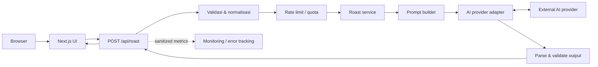
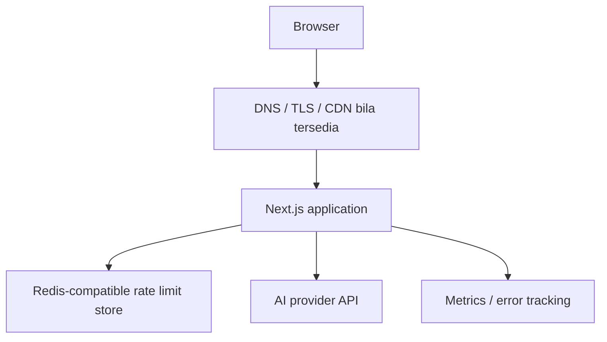

# 04. Architecture & Tech Stack — AI Laptop Roaster

## Daftar Isi

1. [Ringkasan Eksekutif](#1-ringkasan-eksekutif)
2. [Konteks dan Asumsi](#2-konteks-dan-asumsi)
3. [Arsitektur Sistem](#3-arsitektur-sistem)
4. [Technology Stack](#4-technology-stack)
5. [Struktur Aplikasi](#5-struktur-aplikasi)
6. [Database dan Data Storage](#6-database-dan-data-storage)
7. [Integrasi AI dan API Contract](#7-integrasi-ai-dan-api-contract)
8. [Security, Privacy, dan Cost Control](#8-security-privacy-dan-cost-control)
9. [Deployment dan Infrastruktur](#9-deployment-dan-infrastruktur)
10. [Performance, Observability, dan Recovery](#10-performance-observability-dan-recovery)
11. [Testing dan CI/CD](#11-testing-dan-cicd)
12. [Scaling Strategy](#12-scaling-strategy)
13. [ADR dan Risk Register](#13-adr-dan-risk-register)
14. [Open Decisions dan Checklist](#14-open-decisions-dan-checklist)

## 1. Ringkasan Eksekutif

### 1.1 Rekomendasi utama

Bangun **modular monolith menggunakan Next.js + TypeScript**. UI dan endpoint backend berada dalam satu repository dan satu unit deployment. Panggilan AI hanya dilakukan server-side melalui adapter internal. Untuk MVP, **jangan menambahkan database aplikasi** sebelum ada kebutuhan persistence yang disetujui. Rate limiting production sebaiknya memakai store bersama seperti Redis-compatible service jika aplikasi publik atau berjalan pada beberapa instance.

Pendekatan ini paling seimbang untuk tim kecil: delivery cepat, operasi sederhana, dan tetap memiliki batas modul yang jelas untuk perubahan berikutnya.

### 1.2 Ringkasan keputusan

| Area | Rekomendasi | Alasan/trade-off |
|---|---|---|
| Architecture | Modular monolith | Tidak menambah kompleksitas microservices |
| Repository | Satu repository | UI, API, schema, dan tests mudah dikoordinasikan |
| Language | TypeScript | Tipe bersama dan pemeriksaan compile-time |
| Framework | Next.js | UI dan server-side API dalam satu aplikasi |
| Styling | Tailwind CSS | Iterasi layout/responsive efisien |
| Runtime validation | Zod atau schema validator setara | Validasi input dan output AI saat runtime |
| AI integration | Server-side provider adapter | API key aman dan mengurangi vendor lock-in |
| Database | Tidak diperlukan pada MVP awal | Tidak ada akun/riwayat server yang dikonfirmasi |
| Rate limiting | Redis-compatible store untuk production public/multi-instance | Counter konsisten lintas instance |
| Queue | Belum diperlukan | Request/response cukup jika latency provider sesuai |
| File storage | Belum diperlukan | Upload gambar/OCR bukan scope MVP |
| Testing | Unit, integration, contract, E2E, AI golden set | Output model bersifat probabilistik |

### 1.3 Batas keputusan

Provider/model AI, hosting, anggaran, analytics provider, dan angka limit belum dikunci. Nomor versi framework dan SDK harus diverifikasi dari dokumentasi resmi saat implementasi karena dapat berubah.

## 2. Konteks dan Asumsi

### 2.1 Kebutuhan yang menjadi dasar

- Aplikasi web berbahasa Indonesia.
- Input melalui form manual atau paste teks spesifikasi.
- Output berupa roast yang brutal/lucu tetapi fokus pada perangkat, plus kekuatan, keterbatasan, dan kecocokan penggunaan.
- Hasil dapat disalin atau dibagikan.
- Produk gratis dan viral-oriented.
- API key tidak boleh terekspos ke browser.
- Raw input tidak disimpan permanen secara default.
- Kontrol biaya, abuse prevention, error handling, dan monitoring wajib dipertimbangkan.

### 2.2 Known / Assumed / Unknown

**Known**
- Nama produk: AI Laptop Roaster.
- Platform: web.
- Input: form manual dan paste teks.
- Bahasa: Indonesia; gaya roast brutal; target pengalaman mudah dibagikan.

**Assumed**
- Tidak ada login pada MVP.
- Tidak ada riwayat roast tersimpan di server.
- Satu provider AI digunakan pada tahap awal.
- Tidak ada upload file atau OCR.
- Deployment menggunakan runtime yang mendukung Next.js/Node.js.

**Unknown**
- Provider/model dan harga aktual.
- Budget bulanan serta batas biaya per roast.
- Hosting/domain/region.
- Kebutuhan analytics historis.
- Target latency, traffic, dan rate limit final.
- Bentuk share card. Default sementara: copy/share text dan Web Share API bila browser mendukung; tidak membuat URL hasil persisten.

## 3. Arsitektur Sistem

### 3.1 Gaya arsitektur

Gunakan modular monolith. Pisahkan tanggung jawab secara logis, tetapi deploy sebagai satu aplikasi sampai metrik dan kebutuhan organisasi membuktikan perlunya pemisahan.



### 3.2 Modul utama

1. **Presentation:** form, loading/error states, result card, copy/share.
2. **Input domain:** validasi, normalisasi, dan penyatuan input manual/paste.
3. **Roast service:** orkestrasi satu request.
4. **Prompt management:** template prompt berversi dan grounding rules.
5. **Provider adapter:** panggilan provider, timeout, retry terbatas, pemetaan error.
6. **Output contract:** parsing dan validasi schema.
7. **Abuse/cost control:** rate limit, request-size limit, quota, token/output cap.
8. **Observability:** metrik terstruktur yang tidak mencatat raw input secara default.

### 3.3 Mengapa bukan microservices?

Untuk MVP, domain dan tim masih kecil. Microservices akan menambah deployment, network failure modes, observability, dan biaya operasi tanpa manfaat yang sudah terbukti. Evaluasi ulang jika generation workload perlu diskalakan terpisah, proses menjadi asynchronous, atau ownership tim terpisah.

## 4. Technology Stack

### 4.1 Stack yang direkomendasikan

| Layer | Pilihan awal | Catatan |
|---|---|---|
| Language | TypeScript, strict mode | Dipakai pada frontend dan backend |
| Web framework | Next.js | UI dan server API dalam satu app |
| UI | React | Komponen interaktif |
| Styling | Tailwind CSS | Token desain tetap dikelola dalam design foundation |
| Validation | Zod atau setara | Schema request/response dan output AI |
| AI SDK | SDK resmi provider terpilih melalui adapter internal | Jangan panggil SDK dari komponen UI |
| Unit/integration tests | Vitest atau runner kompatibel | Pilih satu runner utama |
| E2E | Playwright | Uji flow browser utama |
| Lint/type | ESLint + TypeScript checks | Wajib di CI |
| Package manager | pnpm atau npm | Pilih satu dan commit lockfile |
| Deployment packaging | Docker jika didukung target hosting | Build reproducible dan portabilitas |
| Rate-limit state | Redis-compatible service bila public/multi-instance | In-memory hanya untuk development/test |
| Error tracking | Provider yang disetujui | Redact request body dan header |
| Analytics | Event minimal/agregat | Provider belum diputuskan |

Versi pasti framework, runtime, dan SDK tidak dikunci di dokumen ini. Verifikasi compatibility matrix, versi stabil, pricing, dan limit melalui dokumentasi resmi saat implementasi.

### 4.2 Alternatif maksimal dua

- **Vite + React dengan backend terpisah:** cocok jika sudah ada backend platform yang wajib digunakan. Trade-off: dua aplikasi/deployment dan kontrak API terpisah.
- **Frontend statis + serverless API:** cocok jika platform serverless sesuai untuk durasi request provider. Trade-off: perlu memeriksa cold start, timeout, quota, dan rate limiting terdistribusi.

Rekomendasi utama tetap Next.js modular monolith sampai constraint hosting/tim menunjukkan alternatif lebih tepat.

## 5. Struktur Aplikasi

### 5.1 Struktur direktori awal

```text
ai-laptop-roaster/
├── app/
│   ├── page.tsx
│   ├── layout.tsx
│   ├── api/
│   │   ├── roast/route.ts
│   │   └── health/route.ts
│   └── error.tsx
├── components/
│   ├── roast-form/
│   ├── roast-result/
│   ├── feedback/
│   └── ui/
├── features/roast/
│   ├── schemas.ts
│   ├── normalize-input.ts
│   ├── roast-service.ts
│   ├── prompt-template.ts
│   ├── output-parser.ts
│   └── types.ts
├── server/
│   ├── ai/provider-adapter.ts
│   ├── ai/provider-errors.ts
│   ├── rate-limit/
│   ├── config/
│   └── observability/
├── tests/
│   ├── unit/
│   ├── integration/
│   ├── e2e/
│   └── ai-golden-set/
├── docs/adr/
├── public/
├── .env.example
├── package.json
├── lockfile
└── README.md
```

### 5.2 Dependency rules

- Komponen browser tidak boleh memanggil AI provider langsung.
- API key hanya tersedia pada server.
- `roast-service` tidak bergantung langsung pada SDK vendor.
- Provider adapter menjadi satu-satunya boundary untuk SDK provider.
- Schema request/response diuji dan dipakai secara konsisten.
- Logging menerima metadata yang sudah disanitasi.
- Config divalidasi saat startup; secret tidak masuk Git, bundle browser, atau image.

## 6. Database dan Data Storage

### 6.1 Keputusan MVP: tanpa database aplikasi

Saat ini tidak ada kebutuhan yang dikonfirmasi untuk akun, riwayat roast, katalog perangkat, atau data transaksional. Karena itu, database aplikasi belum diperlukan. Ini mengurangi biaya operasi, migration, backup, dan risiko privacy.

| Data | Lokasi | Penanganan default |
|---|---|---|
| Input spesifikasi | Memory request/browser state | Tidak disimpan permanen di server |
| Output roast | Response dan UI state | Tidak ada riwayat server |
| Rate-limit counters | Redis-compatible store bila digunakan | TTL pendek; jangan gunakan raw input sebagai key |
| Operational metrics | Monitoring/analytics | Metadata minimal/agregat |
| Error metadata | Error tracking | Sanitasi body, header, token |
| API key | Secret manager/environment | Server-side; akses terbatas |

### 6.2 Kapan database diperlukan?

Tambahkan PostgreSQL atau database relasional setara hanya jika scope disetujui untuk akun, riwayat, leaderboard, katalog, quota per akun, atau admin console. Sebelum implementasi, definisikan schema, data ownership, retensi, penghapusan, access control, migration, backup, dan restore test.

Object storage belum diperlukan karena upload/OCR bukan scope MVP. Jika kelak ditambahkan, lakukan validasi tipe/ukuran, akses terbatas, nama object acak, lifecycle deletion, dan threat review.

## 7. Integrasi AI dan API Contract

### 7.1 Provider adapter

Gunakan interface internal supaya domain tidak terkunci ke satu vendor.

```ts
export type RoastRequest = {
  cpu?: string;
  gpu?: string;
  ram?: string;
  storage?: string;
  usage?: string;
  pastedSpecs?: string;
};

export type RoastResult = {
  title: string;
  roast: string;
  strengths: string[];
  limitations: string[];
  usageFit: string;
  shareText: string;
};

export interface RoastProvider {
  generateRoast(input: RoastRequest): Promise<RoastResult>;
}
```

Kontrak ini konseptual; field final wajib diselaraskan dengan schema PRD sebelum coding.

### 7.2 Aturan AI

- Prompt/template disimpan server-side dan diberi versi.
- Input paste diperlakukan sebagai data, bukan instruksi yang dapat mengganti aturan sistem.
- Jangan menyatakan spesifikasi yang tidak diberikan sebagai fakta.
- Jika informasi tidak cukup, output harus mengakui ketidakpastian.
- Humor fokus pada perangkat/performa/kompromi, bukan menyerang pengguna.
- Output model harus di-parse dan divalidasi; jangan percaya output sebagai JSON valid tanpa pemeriksaan.
- Batasi input, output tokens, panjang roast, dan jumlah item.
- Perubahan prompt/model/provider wajib menjalani evaluasi golden set.

### 7.3 Endpoint

| Method | Path | Tujuan |
|---|---|---|
| POST | `/api/roast` | Validasi input dan menghasilkan roast |
| GET | `/api/health` | Health check minimal |

Endpoint generasi bersifat public sehingga harus dilindungi rate limit/quota. Health check tidak boleh mengungkap credential, environment variables, stack trace, atau detail sensitif provider.

### 7.4 Response konseptual

```json
{
  "ok": true,
  "result": {
    "title": "Judul roast",
    "roast": "Teks roast",
    "strengths": ["Kekuatan yang didukung input"],
    "limitations": ["Keterbatasan yang didukung input"],
    "usageFit": "Ringkasan kecocokan",
    "shareText": "Teks siap disalin/dibagikan"
  },
  "requestId": "opaque-request-id"
}
```

Error response harus konsisten dan aman. Gunakan status yang sesuai: `200` sukses, `400` input tidak valid, `413` payload terlalu besar, `429` rate limit, `502` respons upstream tidak valid, `503` layanan sementara tidak tersedia, dan `504` timeout. Jangan mengembalikan stack trace atau response mentah provider.

### 7.5 Pemilihan provider/model

Lakukan technical spike dengan golden set yang sama. Bandingkan kualitas Bahasa Indonesia, grounding, schema validity, latency median/p95, harga aktual, rate limits, reliability, data processing terms, dan perilaku logging/retention. Pilih berdasarkan hasil produk ini, bukan popularitas atau benchmark umum saja.

## 8. Security, Privacy, dan Cost Control

### 8.1 Kontrol minimum

- [ ] API key hanya di server-side secret configuration.
- [ ] Validasi input dilakukan di frontend dan backend.
- [ ] Batas keras pada ukuran request, panjang field, durasi request, dan output tokens.
- [ ] Rate limiting dan quota sebelum panggilan provider.
- [ ] Timeout dan retry terbatas; jangan retry untuk semua error.
- [ ] Output AI divalidasi dan dirender sebagai teks, bukan HTML tepercaya.
- [ ] Prompt injection dianggap sebagai input tidak tepercaya.
- [ ] Error publik tidak menampilkan stack trace, prompt internal, atau credential.
- [ ] TLS, security headers, CORS, dependency scanning, dan secret scanning ditinjau.
- [ ] Raw input/prompt tidak disimpan atau dicatat secara default.
- [ ] Privacy notice sesuai provider dan praktik retensi aktual.

### 8.2 Rate limiting dan budget guardrails

Angka final harus ditetapkan setelah provider dan budget dipilih.

| Control | Rekomendasi |
|---|---|
| Per-client rate limit | Menahan burst request |
| Global quota | Batas pemakaian harian/bulanan |
| Output cap | Membatasi panjang respons dan biaya |
| Timeout | Membatasi request menggantung |
| Retry cap | Menghindari biaya berulang |
| Kill switch | Menonaktifkan generasi saat provider/biaya bermasalah |
| Alert | Volume, error, latency, dan biaya mendekati threshold |

Untuk local development, in-memory limiter dapat diterima. Untuk production public atau multi-instance, gunakan store bersama seperti Redis-compatible service. Hindari raw input sebagai key; minimalkan retensi identifier seperti IP.

### 8.3 Logging minimization

Log yang dianjurkan: request ID, latency, status, kategori error, model/version, ukuran input berbentuk bucket, dan metadata token/biaya bila tersedia. Jangan log raw pasted specs, prompt lengkap, secret, header sensitif, atau output lengkap secara default.

## 9. Deployment dan Infrastruktur

### 9.1 Topologi awal



### 9.2 Persyaratan deployment

- HTTPS/TLS aktif.
- Environment terpisah: local, CI/test, staging, production.
- Secret terpisah per environment dan tidak dimasukkan ke repository/image.
- Build reproducible dengan lockfile.
- Health check, restart policy, log access, dan resource limits.
- Deployment sebelumnya dapat dipulihkan.
- CORS, security headers, body size limits, dan provider timeout dikonfigurasi.
- Deployment dan rollback diuji di staging sebelum launch.
- Jika Docker dipakai: multi-stage build bila sesuai, non-root runtime bila didukung, base image terpelihara, dan image scan.

### 9.3 Kriteria memilih hosting

Bandingkan dukungan runtime, biaya tetap/bandwidth, secret management, request timeout, log/metrics, rollback, region/latency ke provider AI, resource limit, dan ketersediaan Redis-compatible service. Hosting belum dikunci karena budget dan deployment target masih open decision.

## 10. Performance, Observability, dan Recovery

### 10.1 Performance

Latency utama diperkirakan berasal dari AI provider; ukur secara terpisah:
- frontend load/interaction;
- validasi backend;
- rate-limit lookup;
- provider round-trip;
- parsing/schema validation;
- total request latency.

Jangan mengarang SLA sebelum benchmark. Sebelum launch, PO perlu menyetujui target p95 latency, error/timeout rate, cost per successful roast, concurrency, dan tindakan saat threshold terlampaui.

### 10.2 Metrik dan alert

| Metrik | Tujuan |
|---|---|
| Request/success/error rate | Reliability |
| Latency p50/p95 | UX dan bottleneck |
| Provider timeout/error | Ketergantungan eksternal |
| Schema validation failure | Kualitas output AI |
| Rate-limit events | Abuse prevention |
| AI cost/token usage | Kontrol biaya |
| CPU/memory | Kapasitas aplikasi |
| Copy/share action | Indikator engagement |

Alert minimum: error/timeout melonjak, provider unavailable, biaya mendekati budget, schema failures meningkat, resource mendekati batas, atau rate-limit store tidak tersedia. Hindari raw prompt dan user-entered strings sebagai label metrik.

### 10.3 Backup dan recovery

Karena tidak ada database aplikasi, backup utama adalah source code, deployment manifests/configuration yang aman, prompt templates, golden set, dan konfigurasi monitoring. Secret harus tetap di secret manager. Uji redeploy dari commit yang diketahui baik dan dokumentasikan rollback. Jika database ditambahkan kelak, tentukan RPO/RTO, backup terenkripsi/offsite, dan restore drill sebelum production.

## 11. Testing dan CI/CD

### 11.1 Pipeline minimum

1. Install dependency dari lockfile.
2. Lint/format check dan type check.
3. Unit tests untuk schema, normalisasi, dan business rules.
4. Integration/contract tests dengan mock provider.
5. Dependency dan secret scanning.
6. Build.
7. E2E flow di staging.
8. Manual approval untuk production pada fase awal.
9. Production smoke test dan observability check.

### 11.2 AI golden set

Gunakan input sintetis yang mencakup: spesifikasi lengkap, paste text berantakan, data tidak lengkap/kontradiktif, perangkat entry-level dan gaming, prompt injection, output malformed, timeout, serta provider rate limit.

Evaluasi properti yang stabil, bukan exact wording: schema valid, Bahasa Indonesia, relevansi pada input, ketidakpastian diakui, tidak mengarang spesifikasi, tidak membocorkan prompt, dan tone sesuai.

## 12. Scaling Strategy

| Tahap | Pendekatan | Trigger untuk berkembang |
|---|---|---|
| MVP | Satu modular monolith, satu provider, tanpa DB aplikasi | Validasi produk awal |
| Growth | Shared rate-limit store, beberapa instance, CDN/cache asset, cost monitoring | Traffic/availability membutuhkan |
| Feature expansion | PostgreSQL, queue, object storage, atau service terpisah | Requirement persistence/upload/asynchronous atau bottleneck terukur |

Jangan menambahkan microservices, queue, database, atau object storage hanya untuk mengantisipasi traffic hipotetis tanpa bukti kebutuhan.

## 13. ADR dan Risk Register

### 13.1 Architecture Decision Records

| ID | Keputusan | Status | Alasan | Konsekuensi |
|---|---|---|---|---|
| ADR-001 | Modular monolith | Recommended | Tim kecil dan satu domain utama | UI/API satu siklus deployment |
| ADR-002 | Next.js + TypeScript | Recommended | Full-stack web dengan tipe bersama | Hosting harus sesuai runtime |
| ADR-003 | Tidak ada DB aplikasi pada MVP | Recommended, bergantung scope | Belum ada persistence requirement | Tidak ada riwayat server |
| ADR-004 | Provider adapter internal | Required | Mengurangi vendor lock-in | Abstraksi kecil perlu dipelihara |
| ADR-005 | Server-side output schema validation | Required | Output AI tidak selalu valid | Perlu fallback dan contract tests |
| ADR-006 | Rate limit dan cost guardrail sebelum launch | Required | Produk gratis dan berpotensi viral | Limit perlu ditetapkan |
| ADR-007 | Raw input tidak disimpan default | Recommended | Privacy minimization | Debugging mengandalkan metadata aman |
| ADR-008 | Queue belum dipakai | Recommended | Request/response cukup selama latency sesuai | Desain ulang jika async diperlukan |

Untuk setiap ADR berikutnya, catat ID/tanggal/status, konteks, opsi, keputusan, alasan, trade-off, requirement terdampak, owner, dan rollback/exit strategy.

### 13.2 Risk register

| ID | Risiko | Dampak | Mitigasi |
|---|---|---|---|
| RISK-01 | Biaya AI melonjak | Tinggi | Quota, token cap, rate limit, monitoring, kill switch |
| RISK-02 | Provider outage/timeout | Tinggi | Timeout, retry terbatas, error state, alert |
| RISK-03 | AI mengarang spesifikasi | Tinggi | Grounding rules, schema, golden set |
| RISK-04 | API key terekspos | Kritis | Server-side secret, scanning, least privilege, rotation |
| RISK-05 | In-memory limiter pada multi-instance | Tinggi | Shared store dan cross-instance tests |
| RISK-06 | Raw input masuk log | Tinggi | Redaction, minimisasi, log inspection tests |
| RISK-07 | Hosting membatasi durasi request | Sedang–tinggi | Verifikasi limit dan benchmark sebelum memilih |
| RISK-08 | Model/harga berubah | Sedang–tinggi | Re-evaluasi golden set dan biaya; version tracking |
| RISK-09 | Scope creep | Sedang | P0/P1/P2 dan change control |

## 14. Open Decisions dan Checklist

### 14.1 Open decisions

1. Provider/model AI berdasarkan hasil spike, biaya, latency, dan data terms.
2. Budget bulanan, batas harian, dan target cost per roast.
3. Hosting, domain, region, dan batas request.
4. Rate limit values dan tindakan ketika quota tercapai.
5. Analytics/error tracking provider serta retensi.
6. Bentuk share experience final.
7. Target p95 latency, error threshold, dan owner incident.
8. Apakah requirement baru mengharuskan database.

### 14.2 Checklist sebelum coding

- [ ] PRD dan SDLC disetujui.
- [ ] UX Architecture/design direction tersedia.
- [ ] Provider/model dipilih setelah technical spike.
- [ ] Hosting dan deployment target dipilih.
- [ ] Budget dan cost guardrails ditentukan.
- [ ] Request/response schema diselaraskan dengan PRD.
- [ ] Threat/privacy review dilakukan.

### 14.3 Checklist sebelum production

- [ ] API key hanya server-side.
- [ ] Rate limit, quota, input-size cap, output cap, dan timeout aktif.
- [ ] Retry/fallback dan provider failure diuji.
- [ ] Output schema validation server-side aktif.
- [ ] Raw input tidak disimpan/logged secara default.
- [ ] Monitoring, alert, health check, dan kill switch tersedia.
- [ ] Golden set, E2E, dan smoke tests lulus.
- [ ] Rollback/recovery diuji.
- [ ] Privacy notice sesuai implementasi aktual.
- [ ] Budget, release guardrails, dan incident owner disetujui.

### 14.4 Status artefak

| Artefak | Status |
|---|---|
| 01 — Project Blueprint | ACC menurut catatan percakapan |
| 02 — PRD | ACC menurut catatan percakapan |
| 03 — SDLC | ACC oleh pengguna |
| 04 — Architecture & Tech Stack | Draft v1.0 — siap ditinjau |
| 05 — UX Architecture | Belum dibuat |
| 06 — Design Foundation | Belum dibuat |
| 07 — Stitch Prompts | Belum dibuat |
| 08 — Master Handoff | Belum dibuat |

**Tahap berikutnya:** UX Architecture — Information Architecture, user flows, screen inventory, access matrix, dan seluruh system states.

**Approval yang diminta:** tinjau rekomendasi modular monolith, Next.js + TypeScript, keputusan tanpa database pada MVP, serta kontrol AI/rate-limit. Konfirmasi dengan **ACC** atau sebutkan bagian yang ingin direvisi.
