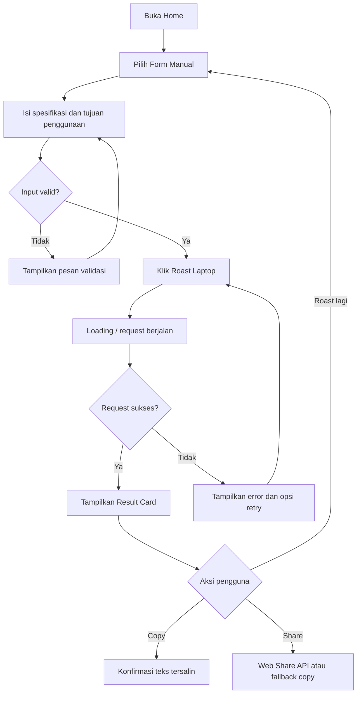

# 05. UX Architecture — AI Laptop Roaster

## Daftar Isi

1. [Ringkasan dan Tujuan UX](#1-ringkasan-dan-tujuan-ux)
2. [UX Principles](#2-ux-principles)
3. [Information Architecture](#3-information-architecture)
4. [Role dan Access Matrix](#4-role-dan-access-matrix)
5. [Screen Inventory](#5-screen-inventory)
6. [Core User Flows](#6-core-user-flows)
7. [Spesifikasi Layar](#7-spesifikasi-layar)
8. [Form dan Input Rules](#8-form-dan-input-rules)
9. [System States dan Error Handling](#9-system-states-dan-error-handling)
10. [Responsive Behavior](#10-responsive-behavior)
11. [Accessibility](#11-accessibility)
12. [Content Design dan Microcopy](#12-content-design-dan-microcopy)
13. [Analytics dan UX Measurement](#13-analytics-dan-ux-measurement)
14. [SEO dan Sharing](#14-seo-dan-sharing)
15. [Traceability ke Requirement](#15-traceability-ke-requirement)
16. [Urutan Implementasi dan Acceptance Checklist](#16-urutan-implementasi-dan-acceptance-checklist)
17. [Open Decisions dan Approval](#17-open-decisions-dan-approval)

## 1. Ringkasan dan Tujuan UX

### 1.1 Tujuan

UX AI Laptop Roaster harus membantu pengguna memasukkan spesifikasi laptop dengan cepat, mendapatkan roast berbahasa Indonesia yang lucu dan tajam, lalu menyalin atau membagikannya tanpa hambatan.

Pengalaman utama harus terasa:
- **Cepat:** pengguna dapat langsung mulai tanpa membuat akun.
- **Jelas:** pengguna paham data apa yang perlu dimasukkan dan apa yang akan dihasilkan.
- **Menghibur:** karakter humor terasa kuat tanpa mengorbankan keterbacaan.
- **Dapat dipercaya:** sistem tidak menyatakan spesifikasi yang tidak diberikan sebagai fakta.
- **Tahan gagal:** input tidak hilang secara tidak perlu saat error dan pengguna memiliki tindakan pemulihan yang jelas.
- **Aman:** input tidak diminta melebihi kebutuhan dan hasil AI ditampilkan sebagai teks.

### 1.2 Ruang lingkup UX MVP

- Satu halaman utama dengan pilihan input manual atau paste teks.
- Validasi input dan petunjuk spesifikasi.
- Status loading saat roast dibuat.
- Result card dengan roast, strengths, limitations, dan usage fit.
- Aksi copy dan share bila didukung browser.
- Error states untuk validasi, rate limit, provider failure, dan network failure.
- Informasi privasi singkat yang sesuai dengan implementasi aktual.

Di luar scope UX MVP: akun, dashboard pengguna, riwayat roast server-side, upload gambar/OCR, leaderboard, katalog laptop, dan pembelian.

## 2. UX Principles

| ID | Prinsip | Penerapan |
|---|---|---|
| UX-01 | Input-first | Form terlihat jelas tanpa onboarding panjang |
| UX-02 | Humor dengan substansi | Roast menghibur, tetapi kekuatan dan batas perangkat tetap informatif |
| UX-03 | Progressive disclosure | Field manual dan paste mode ditampilkan sederhana; petunjuk tambahan tidak mendominasi |
| UX-04 | Honest AI | Ketidakpastian spesifikasi dinyatakan, bukan ditutupi |
| UX-05 | Recoverable | Error memiliki instruksi yang dapat ditindaklanjuti dan input dipertahankan bila aman |
| UX-06 | Mobile-first | Form, hasil, dan tombol nyaman digunakan di layar kecil |
| UX-07 | Shareable by design | Hasil memiliki teks ringkas yang mudah disalin/dibagikan |
| UX-08 | Privacy by default | Tidak meminta nama, email, atau akun untuk membuat roast |
| UX-09 | Accessible | Navigasi keyboard, label, kontras, dan status yang dapat dibaca teknologi bantu |
| UX-10 | Cost-aware UX | Pengguna mendapat feedback jelas saat limit atau layanan sedang tidak tersedia |

## 3. Information Architecture

### 3.1 Struktur navigasi MVP

MVP cukup menggunakan satu halaman utama. Navigasi global tidak perlu kompleks.

```text
AI Laptop Roaster
└── Home / Roast Laptop
    ├── Input Mode
    │   ├── Form Manual
    │   └── Paste Spesifikasi
    ├── Generate Roast
    ├── Result
    │   ├── Roast Utama
    │   ├── Kekuatan
    │   ├── Keterbatasan
    │   ├── Cocok Untuk
    │   └── Copy / Share
    └── Help / Privacy Note
```

### 3.2 Navigasi dan hierarchy

- Brand/title berada di bagian atas.
- Headline menjelaskan nilai produk dalam satu kalimat.
- Input panel menjadi fokus utama.
- Result panel muncul setelah generasi berhasil.
- Error/loading status ditampilkan dekat konteks tindakan.
- Privacy note dan batas penggunaan ditempatkan dekat tombol generate atau di footer.
- Hindari navigasi yang membuat pengguna meninggalkan hasil tanpa sengaja.

## 4. Role dan Access Matrix

MVP tidak memiliki login atau role-based dashboard. Pengguna umum dapat mengakses fungsi utama.

| Capability | Pengguna anonim | Operator/developer |
|---|---:|---:|
| Membuka halaman | Ya | Ya |
| Memasukkan spesifikasi | Ya | Untuk testing |
| Membuat roast | Ya, sesuai rate limit | Untuk testing/diagnostik melalui jalur internal |
| Melihat hasil di sesi aktif | Ya | Ya |
| Copy/share hasil | Ya | Ya |
| Melihat riwayat server | Tidak | Tidak tersedia pada MVP |
| Mengelola provider secret | Tidak | Melalui secret configuration platform, bukan UI produk |
| Melihat operational metrics | Tidak | Hanya dengan akses sistem yang disetujui |
| Mengubah quota/kill switch | Tidak | Operator berwenang melalui konfigurasi/operasi |

Catatan: tidak boleh ada halaman admin publik atau mekanisme perubahan quota tanpa autentikasi yang sesuai.

## 5. Screen Inventory

| Screen ID | Nama layar | Tujuan | Prioritas | Requirement terkait |
|---|---|---|---|---|
| SCR-01 | Home / Input | Memulai roast dan menerima spesifikasi | P0 | FR input, validasi, generate |
| SCR-02 | Generating State | Menunjukkan proses sedang berjalan | P0 | FR loading, feedback |
| SCR-03 | Roast Result | Menampilkan hasil terstruktur | P0 | FR output, strengths, limitations, usage fit |
| SCR-04 | Validation Feedback | Membantu memperbaiki input | P0 | FR validation |
| SCR-05 | Service/Error State | Menjelaskan kegagalan dan recovery | P0 | FR error/retry |
| SCR-06 | Share/Copy Feedback | Memberi konfirmasi aksi copy/share | P0 | FR copy/share |
| SCR-07 | Privacy/Usage Note | Menjelaskan penggunaan input dan limit secara ringkas | P1 | NFR privacy, security |
| SCR-08 | Not Found / Generic Error Boundary | Menangani route/error tak terduga | P1 | NFR reliability |

ID requirement harus dipetakan ke ID persis dari PRD final saat implementasi; label fungsi di tabel ini bersifat ringkasan dan tidak menggantikan PRD.

## 6. Core User Flows

### 6.1 Flow utama: input manual → roast → copy/share



### 6.2 Flow paste text

1. Pengguna memilih mode paste.
2. Pengguna menempelkan teks spesifikasi.
3. UI menampilkan batas/petunjuk format.
4. Frontend melakukan validasi dasar.
5. Pengguna menekan tombol generate.
6. Backend memvalidasi ulang dan memproses request.
7. Hasil ditampilkan pada result card.
8. Pengguna dapat copy/share atau kembali mengedit input.

### 6.3 Flow rate limit/provider failure

1. Pengguna mengirim request.
2. Backend menolak request karena limit atau provider error.
3. UI menampilkan pesan yang tidak membocorkan detail internal.
4. Jika rate limited, UI memberi arahan untuk menunggu sebelum mencoba lagi.
5. Jika transient failure, UI menyediakan retry manual.
6. Input pengguna dipertahankan selama sesi bila aman.
7. Jangan auto-retry berkali-kali karena dapat membuat biaya tambahan.

## 7. Spesifikasi Layar

### 7.1 SCR-01 — Home / Input

**Objective:** pengguna memahami produk dan dapat memasukkan spesifikasi tanpa hambatan.

**Hierarchy**
1. Brand/title.
2. Headline pendek dan value proposition.
3. Selector input mode: “Isi manual” / “Tempel spesifikasi”.
4. Input fields atau textarea sesuai mode.
5. CTA utama: “Roast laptop gue”.
6. Helper text singkat tentang data yang diperlukan dan privasi.
7. Area hasil belum ditampilkan atau menggunakan placeholder yang tidak mengganggu.

**Form manual**
- CPU/Processor.
- GPU/VGA.
- RAM.
- Storage.
- Tujuan penggunaan.
- Field optional boleh kosong jika schema dan kualitas minimum memungkinkan; aturan minimum harus konsisten dengan PRD.

**Paste mode**
- Textarea dengan placeholder berupa contoh format spesifikasi.
- Counter karakter jika berguna.
- Batas panjang ditampilkan sebelum pengguna terkena error.
- Jangan menyertakan contoh yang memuat PII atau secret.

**Interactions**
- Mengganti mode input tidak boleh menghapus input secara diam-diam tanpa konfirmasi atau kebijakan yang jelas.
- Submit dinonaktifkan saat request berjalan.
- Enter tidak boleh mengirim form ketika pengguna sedang mengetik multiline text; gunakan shortcut/submit behavior yang jelas.
- Error validasi muncul dekat field atau textarea.
- Hasil sebelumnya tidak dihapus saat pengguna mengedit input, kecuali ada alasan UX yang jelas.

**Responsive**
- Mobile: satu kolom, input dan CTA full width.
- Desktop: panel input dengan lebar baca terkontrol; jangan membuat form terlalu melebar.

**Acceptance**
- Pengguna dapat memilih kedua mode input.
- Field memiliki label yang terlihat.
- Validasi tidak hanya mengandalkan placeholder.
- Tombol utama dapat digunakan keyboard dan touch.
- Batas input terlihat sebelum submit.

### 7.2 SCR-02 — Generating State

**Objective:** pengguna memahami request sedang diproses dan tidak mengirim berulang kali.

**Elements**
- Loading indicator yang dapat diakses teknologi bantu.
- Copy status singkat, misalnya “Lagi nyiapin roast…”.
- CTA submit dalam keadaan disabled.
- Jangan menampilkan persentase progress palsu.
- Input tetap tersedia atau terkunci secara konsisten sesuai implementasi.

**Acceptance**
- State muncul segera setelah request dimulai.
- Double submit dicegah di frontend dan backend tetap memiliki rate limit.
- Loading berhenti ketika sukses, gagal, timeout, atau pengguna meninggalkan flow.

### 7.3 SCR-03 — Roast Result

**Objective:** hasil mudah dibaca, menghibur, informatif, dan dapat dibagikan.

**Urutan konten**
1. Label/title hasil.
2. Roast utama sebagai elemen visual dominan.
3. Kekuatan perangkat.
4. Keterbatasan perangkat.
5. Cocok untuk / usage fit.
6. CTA “Salin roast”.
7. CTA “Bagikan” bila didukung.
8. CTA sekunder “Roast lagi” atau “Edit spesifikasi”.

**Rules**
- Jangan mengarang detail spesifikasi yang tidak diberikan.
- Jika informasi kurang, tampilkan caveat secara natural.
- Output ditampilkan sebagai teks aman; tidak merender HTML dari model.
- Konten panjang harus tetap terbaca di mobile.
- Tombol copy sebaiknya memiliki target teks yang jelas: roast saja atau seluruh ringkasan; label harus menyatakan cakupannya.

**Acceptance**
- Seluruh field output yang diwajibkan PRD ditampilkan.
- Copy menghasilkan teks yang sesuai dengan pilihan pengguna.
- Hasil tetap dapat dibaca saat teks panjang.
- Tidak ada action yang terlihat aktif tetapi tidak berfungsi.

### 7.4 SCR-04 — Validation Feedback

**Objective:** menjelaskan input yang salah dan cara memperbaikinya.

**Behavior**
- Tampilkan error dekat field atau textarea.
- Jelaskan tindakan korektif, bukan hanya “invalid”.
- Jangan menghapus field lain yang sudah benar.
- Error hilang atau diperbarui ketika pengguna memperbaiki nilai.
- Backend tetap memvalidasi request walaupun frontend sudah memvalidasi.

Contoh microcopy:
- “Tambahkan sedikit info spesifikasi dulu biar roast-nya nggak ngarang.”
- “Teksnya kepanjangan. Ringkas spesifikasi lalu coba lagi.”

### 7.5 SCR-05 — Service/Error State

**Jenis error**
- Network/client error.
- Rate limit.
- Provider timeout/unavailable.
- Respons AI tidak valid.
- Error tak terduga.

**Behavior**
- Pesan publik singkat dan tidak teknis berlebihan.
- Tampilkan retry hanya bila masuk akal.
- Untuk rate limit, jangan mendorong pengguna mengirim ulang segera.
- Pertahankan input jika memungkinkan.
- Jangan menampilkan stack trace, prompt, API key, atau raw provider error.

### 7.6 SCR-06 — Share/Copy Feedback

**Copy**
- Berikan feedback yang jelas: “Roast tersalin.”
- Jika clipboard API gagal, tampilkan opsi select/copy manual.
- Jangan menganggap copy berhasil sebelum operasi browser berhasil.

**Share**
- Gunakan Web Share API bila tersedia dan sesuai.
- Jika tidak tersedia, fallback ke copy text.
- Tidak ada share URL persisten pada MVP tanpa keputusan penyimpanan hasil.
- Jangan membagikan data input tersembunyi atau metadata yang tidak dimaksudkan pengguna.

### 7.7 SCR-07 — Privacy/Usage Note

Tampilkan ringkasan privasi yang sesuai dengan implementasi final, misalnya bahwa input diproses untuk menghasilkan roast dan tidak disimpan permanen oleh aplikasi jika hal tersebut benar. Jangan membuat klaim retensi yang belum diverifikasi terhadap logging dan provider AI.

### 7.8 SCR-08 — Generic Error Boundary

- Tampilkan pesan pemulihan sederhana.
- Sediakan aksi kembali ke Home.
- Jangan tampilkan stack trace.
- Error boundary harus diuji agar tidak membuat halaman blank.

## 8. Form dan Input Rules

### 8.1 Aturan UX

- Label permanen lebih baik daripada placeholder sebagai satu-satunya label.
- Jelaskan satuan bila relevan, misalnya RAM dalam GB.
- Field manual dan paste text tidak boleh saling bertentangan.
- Berikan contoh format yang singkat dan realistis.
- Batas ukuran harus sama antara UI dan backend; backend tetap menjadi sumber otoritatif.
- Normalisasi whitespace dan karakter yang tidak diperlukan tanpa mengubah makna spesifikasi.
- Jangan menebak atau mengisi spesifikasi kosong sebagai fakta.

### 8.2 Validasi minimum

| Rule ID | Rule | UX response |
|---|---|---|
| UX-RULE-01 | Harus ada informasi minimum yang cukup untuk membuat roast | Jelaskan data yang perlu ditambahkan |
| UX-RULE-02 | Input tidak boleh melewati batas panjang | Tampilkan counter/limit dan arah perbaikan |
| UX-RULE-03 | Field manual harus dibatasi panjangnya | Error dekat field |
| UX-RULE-04 | Mode input harus konsisten dengan payload | Pertahankan pilihan pengguna dan minta perbaikan |
| UX-RULE-05 | Input tidak dipercaya sebagai instruksi sistem | Jangan tampilkan atau ikuti instruksi berbahaya dari paste |
| UX-RULE-06 | Output AI harus sesuai schema | Tampilkan fallback error yang aman bila gagal |

Nilai numerik batas karakter dan aturan minimum harus diambil dari PRD/config final, bukan dibuat berbeda di UX.

## 9. System States dan Error Handling

| State ID | Kondisi | Tampilan/feedback | Tindakan pengguna |
|---|---|---|---|
| STATE-01 | Initial/empty | Form siap digunakan | Isi atau paste spesifikasi |
| STATE-02 | Editing | Input dan helper text | Lanjut mengisi |
| STATE-03 | Client validation error | Error dekat input | Perbaiki nilai |
| STATE-04 | Submitting | Loading; submit disabled | Tunggu |
| STATE-05 | Success | Result card | Copy/share/edit/roast lagi |
| STATE-06 | Network error | Pesan koneksi gagal | Coba lagi |
| STATE-07 | Rate limited | Pesan tunggu sebelum mencoba | Tunggu |
| STATE-08 | Provider timeout/unavailable | Pesan layanan sementara gagal | Retry manual |
| STATE-09 | Invalid model output | Pesan hasil gagal dibuat | Retry terbatas/manual |
| STATE-10 | Copy success | Toast/status “Tersalin” | Lanjut |
| STATE-11 | Copy failure | Fallback manual | Pilih dan salin teks |
| STATE-12 | Share unsupported | Fallback copy | Salin teks |
| STATE-13 | Unexpected error | Error boundary | Kembali ke Home |

### 9.1 State transition rules

- Submit hanya bisa dimulai dari state yang memiliki input cukup.
- Ketika request aktif, cegah duplicate submit.
- Success hanya ditampilkan setelah response lolos validasi.
- Error tidak boleh menghilangkan input tanpa alasan.
- Retry manual harus membuat request baru dan tunduk pada rate limit.
- Jangan membuat optimistic success untuk copy/share.

## 10. Responsive Behavior

| Area | Mobile | Tablet/Desktop |
|---|---|---|
| Main layout | Satu kolom | Satu kolom terkontrol atau dua panel bila hasil dan input berdampingan meningkatkan usability |
| Form fields | Lebar penuh | Grid dua kolom hanya jika label dan value tetap mudah dibaca |
| Textarea | Tinggi cukup untuk paste | Tinggi lebih besar sesuai kebutuhan |
| Result card | Satu kolom, aksi mudah dijangkau | Konten dibatasi lebar baca |
| CTA | Full width atau mudah disentuh | Lebar sesuai hierarchy |
| Error/status | Dekat elemen terkait, tidak terpotong | Sama, tidak hanya bergantung pada warna |
| Long text | Wrap, tidak overflow horizontal | Wrap dan lebar baca konsisten |

Breakpoint final ditentukan di DESIGN.md/implementasi. Uji minimal pada viewport mobile kecil, mobile besar, tablet, dan desktop.

## 11. Accessibility

- Semua input memiliki label programatik dan label visual.
- Semua aksi dapat dijalankan dengan keyboard.
- Focus indicator terlihat.
- Kontras teks dan kontrol memenuhi target WCAG 2.2 AA yang relevan.
- Error dikaitkan ke input terkait dan dijelaskan dengan teks.
- Loading/success/error diumumkan melalui live region yang sesuai.
- Jangan menyampaikan status hanya dengan warna.
- Urutan heading semantik.
- Tombol memiliki nama aksesibel yang jelas.
- Target sentuh cukup besar dan memiliki jarak memadai.
- Hormati reduced-motion preference.
- Pastikan zoom browser tidak merusak layout.
- Uji keyboard-only dan setidaknya satu screen reader pada tahap QA.

## 12. Content Design dan Microcopy

### 12.1 Tone

- Bahasa Indonesia natural, santai, dan konsisten.
- Humor tajam diarahkan ke laptop, spesifikasi, bottleneck, dan kompromi performa.
- Hindari menghina identitas, kondisi personal, atau menyerang pengguna.
- Jangan menjanjikan akurasi benchmark bila tidak melakukan pengukuran.
- Gunakan caveat jika data spesifikasi tidak lengkap.

### 12.2 Contoh microcopy

| Context | Copy |
|---|---|
| Headline | “Masukin spek laptop. Biar kita bedah tanpa ampun.” |
| Helper | “Isi spek yang kamu tahu, atau tempel teks spesifikasinya.” |
| Primary CTA | “Roast laptop gue” |
| Loading | “Lagi nyiapin roast…” |
| Success copy | “Roast tersalin.” |
| Rate limit | “Santai dulu—batas request sementara tercapai. Coba lagi sebentar.” |
| Provider error | “Mesin roast lagi bermasalah. Spek kamu tetap di form; coba lagi nanti.” |
| Insufficient input | “Info speknya masih kurang. Tambahkan detail biar hasilnya nggak asal nuduh.” |
| Share fallback | “Fitur share tidak tersedia di browser ini. Salin teksnya aja.” |

Copy akhir harus sesuai perilaku aplikasi aktual, terutama klaim mengenai penyimpanan dan privasi.

## 13. Analytics dan UX Measurement

### 13.1 Event minimum

| Event | Trigger | Data yang boleh dicatat |
|---|---|---|
| `page_view` | Halaman dibuka | Page, referrer yang diizinkan, timestamp agregat |
| `input_mode_selected` | Mode berubah | Mode manual/paste |
| `roast_submit` | Generate dikirim | Mode, ukuran input dalam bucket |
| `roast_success` | Hasil valid diterima | Durasi, model/version jika aman |
| `roast_error` | Request gagal | Error category, status |
| `copy_clicked` | Copy dipilih | Tipe konten yang disalin |
| `share_clicked` | Share dipilih | API available/fallback |
| `retry_clicked` | Retry dipilih | Kategori error sebelumnya |

Jangan mencatat raw specs, prompt lengkap, output roast lengkap, secret, atau identifier sensitif secara default. Analytics provider dan retention masih merupakan open decision.

### 13.2 Indikator keberhasilan UX

- Rasio pengguna yang memulai dan menyelesaikan roast.
- Rasio request sukses.
- Rasio copy/share.
- Waktu dari submit hingga hasil.
- Rasio error validasi dan provider.
- Repeat use bila dapat diukur dengan pendekatan privacy-preserving.
- Estimasi biaya per successful roast.

Jangan menetapkan target angka tanpa baseline atau keputusan product owner.

## 14. SEO dan Sharing

- Gunakan title dan meta description yang menjelaskan fungsi produk secara jelas.
- Pastikan halaman utama memiliki konten teks yang dapat dipahami mesin pencari.
- Jangan membuat halaman URL hasil yang dapat diindeks sebelum ada desain persistence, privacy, deletion, dan abuse controls.
- Gunakan Web Share API jika didukung, dengan fallback copy.
- Share text harus ringkas, menyertakan roast dan konteks produk tanpa membocorkan input yang tidak dipilih pengguna.
- Metadata Open Graph final bergantung pada brand/design direction.
- Pastikan halaman tetap usable jika JavaScript atau API generasi gagal.

## 15. Traceability ke Requirement

Pemetaan berikut bersifat berdasarkan kategori requirement PRD. Saat PRD final digunakan dalam implementation backlog, ganti kategori dengan ID FR/NFR yang persis sesuai dokumen sumber.

| Screen/Flow | Requirement terkait | Acceptance utama |
|---|---|---|
| SCR-01 / FLOW-01 | Input manual/paste, validasi | Dua mode dapat digunakan dan payload valid |
| SCR-02 | Loading, duplicate-submit prevention | Feedback muncul dan request ganda dicegah |
| SCR-03 | Structured AI result | Semua bagian hasil tampil dan tervalidasi |
| SCR-04 | Input validation | Pesan korektif dekat field |
| SCR-05 | Error/retry/rate limit | Error aman, input dipertahankan, retry terkontrol |
| SCR-06 | Copy/share | Aksi bekerja dan memiliki feedback |
| SCR-07 | Privacy notice | Klaim sesuai implementasi aktual |
| SCR-08 | Reliability/error boundary | Error tak terduga tidak membuat halaman blank |
| All screens | Responsive/accessibility | Keyboard, contrast, status, viewport test lulus |

## 16. Urutan Implementasi dan Acceptance Checklist

### 16.1 Urutan implementasi

1. **Foundation:** typography, spacing, color tokens, layout shell, buttons, inputs, cards, focus states.
2. **SCR-01:** input modes, labels, helper text, validation.
3. **SCR-02:** loading and duplicate-submit prevention.
4. **SCR-03:** result card, copy/share.
5. **SCR-04/SCR-05:** validation and service errors.
6. **SCR-07/SCR-08:** privacy note and error boundary.
7. **Responsive/accessibility pass:** keyboard, screen reader status, contrast, long text.
8. **Analytics:** event naming, minimization, consent/notice as applicable.
9. **E2E and usability review:** happy path, failure paths, mobile/desktop.

### 16.2 Acceptance checklist

- [ ] Pengguna dapat memulai tanpa login.
- [ ] Input manual dan paste text tersedia.
- [ ] Validasi client-side dan server-side konsisten.
- [ ] Loading state dan duplicate-submit prevention bekerja.
- [ ] Hasil memiliki struktur yang jelas dan mudah dibaca.
- [ ] Copy/share bekerja atau memiliki fallback yang jelas.
- [ ] Error validation, network, rate limit, timeout, dan unexpected error memiliki UI.
- [ ] Input dipertahankan saat failure bila aman.
- [ ] Tidak ada raw AI HTML yang dirender sebagai markup tepercaya.
- [ ] Mobile tidak mengalami horizontal overflow.
- [ ] Keyboard focus, labels, contrast, dan live status diuji.
- [ ] Analytics tidak mencatat raw specs/output secara default.
- [ ] Privacy copy telah diverifikasi terhadap implementasi dan provider aktual.

## 17. Open Decisions dan Approval

### 17.1 Open decisions

1. Design direction dan brand personality final akan ditetapkan dalam `06_DESIGN_AI_LAPTOP_ROASTER_v1.0.md`.
2. Detail minimum input, batas karakter, dan output fields harus dicocokkan dengan PRD final.
3. Analytics provider, retention, dan privacy notice final belum diputuskan.
4. Apakah share card berupa gambar akan menjadi scope berikutnya; default MVP tetap copy/share text.
5. Breakpoint dan design tokens final akan ditetapkan pada DESIGN.md.

### 17.2 Status artefak

| Artefak | Status |
|---|---|
| 01 — Project Blueprint | ACC menurut catatan percakapan |
| 02 — PRD | ACC menurut catatan percakapan |
| 03 — SDLC | ACC menurut catatan percakapan |
| 04 — Architecture & Tech Stack | ACC belum dikonfirmasi dalam percakapan ini; draft tersedia |
| 05 — UX Architecture | Draft v1.0 — siap ditinjau |
| 06 — Design Foundation | Belum dibuat |
| 07 — Stitch Prompts | Belum dibuat |
| 08 — Master Handoff | Belum dibuat |

**Tahap berikutnya:** Design Foundation (`DESIGN.md`) — personality, visual direction, semantic colors, typography, spacing, components, motion, responsive, accessibility, dan microcopy.

**Approval yang diminta:** tinjau UX Architecture ini dan konfirmasi dengan **ACC**, atau tuliskan bagian yang ingin direvisi.
