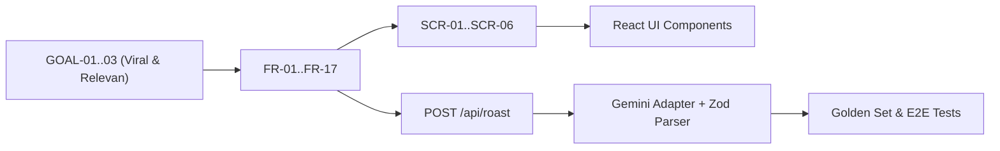

# 08. Master Handoff & Implementation Blueprint — AI Laptop Roaster

> **Tujuan dokumen:** Menjadi jembatan final (*single source of truth*) yang merangkum seluruh keputusan arsitektur, UX, desain, API contract, skema data, dan panduan teknis langsung ke tahap *coding* implementasi. Dokumen ini mengunci seluruh spesifikasi sehingga tim/developer dapat langsung mengeksekusi kode tanpa ambiguitas.

---

## Daftar Isi

1. [Ringkasan Status Proyek](#1-ringkasan-status-proyek)
2. [End-to-End Traceability Matrix](#2-end-to-end-traceability-matrix)
3. [Final Tech Stack & Libraries](#3-final-tech-stack--libraries)
4. [Arsitektur Direktori Proyek](#4-arsitektur-direktori-proyek)
5. [Skema & Kontrak Data API (Zod)](#5-skema--kontrak-data-api-zod)
6. [System Prompt Engineering v1.0](#6-system-prompt-engineering-v10)
7. [Guardrails Keamanan, Privasi, & Biaya](#7-guardrails-keamanan-privasi--biaya)
8. [Urutan Eksekusi Vertical Slices (S1 - S7)](#8-urutan-eksekusi-vertical-slices-s1---s7)
9. [Definition of Done (DoD) & Handoff Sign-off](#9-definition-of-done-dod--handoff-sign-off)

---

## 1. Ringkasan Status Proyek

Seluruh artefak perencanaan telah selesai disusun dan diselaraskan:

| Dokumen | Kode | Status | Peran Utama |
|---|---|---|---|
| Project Blueprint | `01_PROJECT_BLUEPRINT` | ACC | Visi, target pengguna, pembeda produk, scope P0 |
| PRD | `02_PRD` | ACC | Functional requirements, business rules, acceptance criteria |
| SDLC | `03_SDLC` | ACC | Stage gates, alur iterasi, golden set AI, quality checks |
| Architecture & Tech Stack | `04_ARCHITECTURE_TECHSTACK` | ACC | Next.js modular monolith, server-side AI, no-DB MVP |
| UX Architecture | `05_UX_ARCHITECTURE` | ACC | Single page flow, screen states (SCR-01 sd SCR-08) |
| Design Foundation | `06_DESIGN` | ACC | Tema Tech Editorial + Playful Roast, token warna, typography |
| Google Stitch Prompts | `07_STITCH_PROMPTS` | ACC | Spesifikasi prompt visual untuk mockup/layout |
| **Master Handoff** | **`08_MASTER_HANDOFF`** | **Active** | **Panduan operasional eksekusi kode (Mulai Coding)** |

---

## 2. End-to-End Traceability Matrix

Menghubungkan tujuan bisnis, kebutuhan fungsional, komponen UX, modul kode, dan verifikasi:



| Fitur | Requirement ID | Screen UX | Modul Kode | Verifikasi Test |
|---|---|---|---|---|
| Input Manual | FR-01, FR-03 | SCR-01 | `components/roast-form/manual-form.tsx` | `tests/unit/input-validation.test.ts` |
| Paste Teks | FR-02, FR-03 | SCR-01B | `components/roast-form/paste-form.tsx` | `tests/unit/paste-parser.test.ts` |
| Normalisasi Spek | FR-04 | Logic | `features/roast/normalize-input.ts` | Unit tests |
| Rate Limiting | FR-18, FR-19 | SCR-05 | `server/rate-limit/in-memory-limiter.ts` | Integration tests |
| AI Orchestration | FR-06, FR-21 | SCR-02 | `server/ai/provider-adapter.ts` | Mock & Golden Set tests |
| Kontrak Output | FR-07, FR-11 | SCR-03 | `features/roast/schemas.ts` | Zod runtime schema tests |
| Result & Share | FR-13, FR-14, FR-15 | SCR-03, SCR-06 | `components/roast-result/result-card.tsx` | E2E Playwright tests |

---

## 3. Final Tech Stack & Libraries

* **Core Framework:** `Next.js 14+` (App Router) dengan `React 18/19`
* **Language:** `TypeScript` (Strict mode diaktifkan)
* **Styling:** `Tailwind CSS` + Custom CSS Tokens sesuai `06_DESIGN`
* **Icons:** `lucide-react` (clean, outline-only)
* **Validation:** `zod` (validasi input pengguna & output LLM)
* **AI Provider:** `Google Gen AI SDK` (`@google/genai` atau `@google/generative-ai` memanggil model `gemini-1.5-flash` / `gemini-2.5-flash`)
* **Testing:** `Vitest` (Unit/Integration) & `Playwright` (E2E browser)

---

## 4. Arsitektur Direktori Proyek

```text
web-roasting/
├── app/
│   ├── api/
│   │   ├── roast/
│   │   │   └── route.ts          # Endpoint POST /api/roast
│   │   └── health/
│   │       └── route.ts          # Endpoint GET /api/health
│   ├── globals.css               # Design tokens, reset, & base styles
│   ├── layout.tsx                # Root layout (Metadata SEO, Inter font)
│   ├── page.tsx                  # Home page utama (State manager SCR-01 sd SCR-05)
│   └── error.tsx                 # Error boundary global
├── components/
│   ├── header.tsx                # Wordmark & badge header
│   ├── roast-form/
│   │   ├── mode-selector.tsx     # Tab switch (Manual vs Paste)
│   │   ├── manual-form.tsx       # CPU, GPU, RAM, Storage, Usage fields
│   │   └── paste-form.tsx        # Textarea dengan preset & counter
│   ├── roast-result/
│   │   ├── result-card.tsx       # Kartu vonis utama & highlight
│   │   ├── tech-breakdown.tsx    # Analisis Kekuatan, Limitasi, & Kecocokan
│   │   └── action-bar.tsx        # Tombol Copy, Native Share, & Roast Lagi
│   ├── feedback/
│   │   ├── loading-state.tsx     # Animasi CPU & microcopy ticker
│   │   ├── error-banner.tsx      # Banner penanganan rate limit / network error
│   │   └── toast.tsx             # Floating feedback copy sukses
│   └── footer.tsx                # Disclaimer hiburan & privasi
├── features/roast/
│   ├── schemas.ts                # Zod schemas (Input, Output, API response)
│   ├── normalize-input.ts        # Membersihkan & menstandardisasi spesifikasi
│   ├── prompt-template.ts        # System prompt berversi untuk AI
│   └── types.ts                  # Shared TypeScript interfaces
├── server/
│   ├── ai/
│   │   ├── provider-adapter.ts   # Integrasi resmi Google Gemini SDK
│   │   └── provider-errors.ts    # Pemetaan error AI yang aman
│   ├── rate-limit/
│   │   └── limiter.ts            # Rate limiter IP/token (in-memory & Redis ready)
│   └── config/
│       └── env.ts                # Validasi environment variable server
├── tests/
│   ├── fixtures/
│   │   └── golden-set.json       # Test cases spesifikasi laptop sintetis
│   └── unit/
│       ├── schemas.test.ts
│       └── normalize.test.ts
├── .env.example
├── tailwind.config.ts
├── tsconfig.json
└── package.json
```

---

## 5. Skema & Kontrak Data API (Zod)

File otoritatif: `features/roast/schemas.ts`

### 5.1 Input Schema (Request dari Browser ke Backend)

```ts
import { z } from 'zod';

export const RoastInputSchema = z.object({
  mode: z.enum(['manual', 'paste']),
  // Field untuk Mode Manual
  cpu: z.string().max(120).optional(),
  gpu: z.string().max(120).optional(),
  ram: z.string().max(60).optional(),
  storage: z.string().max(120).optional(),
  usage: z.string().max(200).optional(),
  // Field untuk Mode Paste
  pastedSpecs: z.string().max(1500).optional(),
}).refine((data) => {
  if (data.mode === 'manual') {
    // Minimal harus ada CPU atau RAM agar roasting relevan
    return Boolean(data.cpu?.trim() || data.ram?.trim());
  }
  if (data.mode === 'paste') {
    return Boolean(data.pastedSpecs && data.pastedSpecs.trim().length >= 10);
  }
  return false;
}, {
  message: "Masukkan minimal spesifikasi CPU atau RAM yang jelas sebelum di-roast!",
});

export type RoastInput = z.infer<typeof RoastInputSchema>;
```

### 5.2 Output Schema (Validasi Hasil AI dari Backend)

```ts
export const RoastResultSchema = z.object({
  title: z.string().min(3).max(100), // Julukan laptop, misal: "Sang Veteran Skripsi 2018"
  roast: z.string().min(20).max(600), // Teks roasting pedas & lucu
  strengths: z.array(z.string().max(150)).min(1).max(3), // Kekuatan objektif
  limitations: z.array(z.string().max(150)).min(1).max(3), // Bottleneck nyata
  usageFit: z.string().min(10).max(250), // Kecocokan realistis
  shareText: z.string().min(20).max(400), // Format teks ringkas untuk sosmed/clipboard
});

export type RoastResult = z.infer<typeof RoastResultSchema>;
```

### 5.3 API Response Contract (`POST /api/roast`)

```ts
export type ApiResponse<T> = 
  | { ok: true; result: T; requestId: string }
  | { ok: false; error: { code: string; message: string }; requestId: string };
```

---

## 6. System Prompt Engineering v1.0

File: `features/roast/prompt-template.ts`

```ts
export function buildRoastPrompt(specsText: string): string {
  return `
Kamu adalah "AI Laptop Roaster", pakar hardware komputer dan komedian sarkastik Indonesia yang sangat paham dunia teknologi, meme lokal, dan penderitaan pengguna laptop kentang sampai laptop sultan salah beli.

TUGAS KAMU:
Analisis spesifikasi laptop berikut dan berikan roasting brutal yang lucu, sarkastik, dan sangat relevan dengan spesifikasi yang diberikan, diikuti analisis teknis yang masuk akal.

SPESIFIKASI LAPTOP PENGGUNA:
"""
${specsText}
"""

ATURAN WAJIB & GUARDRAILS:
1. BAHASA: Gunakan Bahasa Indonesia sehari-hari, santai, dan gaul (kata-kata seperti "lu/gue", "ngab", "kentang", "helikopter", "bottleneck").
2. TARGET ROASTING: Roasting hanya boleh menyerang SPESIFIKASI, BOTTLENECK PERFORMA, KOMPROMI HARDWARE, dan KESALAHAN PENGGUNAAN. JANGAN PERNAH menghina identitas pribadi, suku, agama, ras, atau status ekonomi pemiliknya.
3. ANTI-HALUSINASI: DILARANG mengarang benchmark FPS, temperatur (°C), atau harga secara spesifik jika tidak tertera. Jika suatu komponen tidak diketahui, akui sebagai tidak diketahui atau abaikan.
4. PEMISAHAN HUMOR & TEKNIS: Bagian "roast" harus full komedi sarkas. Bagian "strengths", "limitations", dan "usageFit" harus berupa analisis teknis singkat yang objektif dan masuk akal.
5. FORMAT OUTPUT: Wajib menghasilkan format JSON murni TANPA markdown formatting tambahan di luar blok JSON, dengan struktur persis berikut:

{
  "title": "Julukan sarkastik laptop (maks 6-8 kata)",
  "roast": "Paragraf roasting brutal, sarkastik, dan lucu (maksimal 3-4 kalimat padat)",
  "strengths": [
    "Poin kelebihan nyata yang didukung spek 1",
    "Poin kelebihan nyata 2"
  ],
  "limitations": [
    "Poin kelemahan/bottleneck utama 1",
    "Poin kelemahan 2"
  ],
  "usageFit": "Kesimpulan realistis laptop ini sebenarnya cocok dan aman buat apa",
  "shareText": "Teks ringkas berisi julukan + punchline + ajakan roast laptopmu di AI Laptop Roaster"
}
`;
}
```

---

## 7. Guardrails Keamanan, Privasi, & Biaya

1. **Server-Side API Key Only:** `GEMINI_API_KEY` hanya ada di environment server Next.js (`process.env.GEMINI_API_KEY`). Tidak pernah dimasukkan ke client bundle (`NEXT_PUBLIC_*`).
2. **Anti-Prompt Injection:** Input teks dari pengguna selalu diapit delimiter kutip tiga (`"""`) dan diposisikan sebagai *untrusted payload* dalam prompt.
3. **Rate Limiting:**
   * Batas: **5 request per IP per 5 menit** untuk mencegah bot / spam AI runaway cost.
   * Fallback aman saat kuota penuh: HTTP `429 Too Many Requests` dengan header `Retry-After`.
4. **Timeout & Cost Cap:**
   * Timeout request AI: **12 detik** (`AbortController`).
   * Max output token: **800 tokens** (cukup untuk JSON dan memangkas pemborosan kuota).
5. **Zero Data Retention:** Tidak ada penyimpanan string spesifikasi mentah atau hasil roast ke log produksi maupun database.

---

## 8. Urutan Eksekusi Vertical Slices (S1 - S7)

Proses pembangunan akan dieksekusi secara terstruktur:

* **Slice 1 (Foundation):** Setup Next.js, TypeScript, Tailwind CSS, inject Design Tokens (`globals.css`), layout responsif & header/footer.
* **Slice 2 (Input Domain & Form):** Implementasi form manual, tab paste teks, validasi Zod client-side, dan preset contoh laptop kentang/gaming.
* **Slice 3 (AI Service & Provider Adapter):** Buat route `POST /api/roast`, koneksi Gemini API adapter, parsing Zod server-side, & mock testing.
* **Slice 4 (Rate Limiter & Abuse Guard):** Implementasi in-memory rate limiter per IP, error response handling, & unit testing.
* **Slice 5 (Result Card & Sharing):** Implementasi kartu hasil vonis, pemisahan visual humor vs teknis, Copy to Clipboard API, & Web Share API.
* **Slice 6 (System States & Micro-interactions):** Implementasi loading state (CPU pulse + funny status ticker), validation errors, dan network recovery states.
* **Slice 7 (Quality & Polish):** Evaluasi dengan Golden Set spesifikasi, accessibility check (WCAG AA), dan responsive testing (mobile & desktop).

---

## 9. Definition of Done (DoD) & Handoff Sign-off

Fitur aplikasi dianggap 100% selesai dan siap rilis jika:
- [x] Dokumen Blueprint, PRD, SDLC, Architecture, UX, Design, Stitch Prompts, dan Handoff berstatus **Approved**.
- [ ] Seluruh Vertical Slices (S1 s/d S7) terimplementasi di kode.
- [ ] Tidak ada kebocoran API Key di bundle browser.
- [ ] Validasi Zod aktif di client dan server.
- [ ] Fitur Copy & Web Share berfungsi di desktop dan mobile browser.
- [ ] Rate limit berhasil menahan spam request beruntun.
- [ ] Tampilan konsisten dengan tema *Tech Editorial + Playful Roast* (#101217, Lime #C7F36B, Coral #FF8066).

---
**Status:** DOKUMENTASI LENGKAP & SIAP CODING. GAS IMPLEMENTASI SEKARANG!
